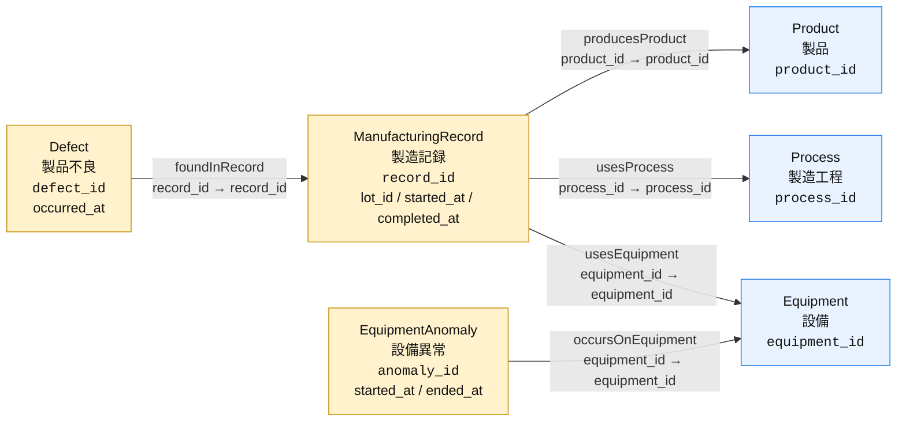

# 製造業オントロジー設計：ロット・設備異常調査

## 目的

製品不良と設備異常を、製造記録・製品・製造工程・設備を介してたどり、次の問いへ回答できるオントロジーを構築する。

> 製品Aの研削工程で寸法不良が発生した。そのロット以降に処理したロットを調査してほしい。

> 設備Aで主軸振動異常が発生した。この寸法不良と関係があるか？

データは6種類、各5行とする。ロットは独立したエンティティにせず、製造記録のプロパティとして持たせる。

## エンティティ型

| エンティティ型 | データソース | 識別子 | 表示に使うプロパティ | 主なプロパティ |
|---|---|---|---|---|
| `Product`（製品） | [products.csv](./products.csv) | `product_id` | `product_name` | `product_category`, `model_code` |
| `Process`（製造工程） | [processes.csv](./processes.csv) | `process_id` | `process_name` | `department`, `standard_minutes` |
| `Equipment`（設備） | [equipment.csv](./equipment.csv) | `equipment_id` | `equipment_name` | `equipment_type`, `location` |
| `ManufacturingRecord`（製造記録） | [manufacturing_records.csv](./manufacturing_records.csv) | `record_id` | `record_id` | `lot_id`, `product_id`, `process_id`, `equipment_id`, `started_at`, `completed_at` |
| `Defect`（製品不良） | [defects.csv](./defects.csv) | `defect_id` | `defect_id` | `record_id`, `defect_type`, `occurred_at` |
| `EquipmentAnomaly`（設備異常） | [equipment_anomalies.csv](./equipment_anomalies.csv) | `anomaly_id` | `anomaly_id` | `equipment_id`, `anomaly_type`, `started_at`, `ended_at` |

`Product`、`Process`、`Equipment`はマスター、`ManufacturingRecord`、`Defect`、`EquipmentAnomaly`はイベントを表すエンティティとして扱う。

### プロパティの扱い

- ID・名称・不良内容・異常内容は文字列、日時は日時型として扱う。CSVの日時はすべて日本時間（`+09:00`）であり、比較時もタイムゾーンをそろえる。
- マスターの追加属性は文字列、`Process.standard_minutes`だけは正の整数として扱う。`standard_minutes`は1ロットの当該工程での標準処理時間（分）の目安であり、実績日時や設備異常の期間の代わりには使用しない。
- `ManufacturingRecord`の1行は、1つの製品ロットを1つの工程・設備で処理した記録を表す。識別子は`lot_id`ではなく`record_id`にする。
- 現在のサンプルは1ロットにつき研削工程の記録が1件である。将来、複数工程の履歴を追加する場合は、同じ`lot_id`に対して工程ごとに別の`record_id`を付ける。
- `Defect.occurred_at`は、工程処理中の不良発生時刻が分かっている想定とする。後日の検査での発見時刻ではない。
- `EquipmentAnomaly.started_at`は異常発生日時、`ended_at`は復旧日時を表す。サンプルの設備異常はすべて復旧済みである。
- [investigation_qa.csv](./investigation_qa.csv)は確認用であり、エンティティのデータソースには使用しない。

## リレーションシップ型

演習では、次の5本を設定する。リレーションシップ名は重複しない英語名にする。

| Origin | Relationship | Target | Origin側のプロパティ | Target側のプロパティ | Mapping table |
|---|---|---|---|---|---|
| `ManufacturingRecord` | `producesProduct` | `Product` | `product_id` | `product_id` | 使用しない |
| `ManufacturingRecord` | `usesProcess` | `Process` | `process_id` | `process_id` | 使用しない |
| `ManufacturingRecord` | `usesEquipment` | `Equipment` | `equipment_id` | `equipment_id` | 使用しない |
| `Defect` | `foundInRecord` | `ManufacturingRecord` | `record_id` | `record_id` | 使用しない |
| `EquipmentAnomaly` | `occursOnEquipment` | `Equipment` | `equipment_id` | `equipment_id` | 使用しない |

### 関係の意味と空値の扱い

- 1つの製造記録は、1つの製品・工程・設備へ接続する。逆方向には、同じ製品・工程・設備を使う複数の製造記録をたどれる。
- 1つの不良は1つの製造記録へ接続する。1つの製造記録には、複数の不良をひも付けられる。
- 1つの設備異常は1つの設備へ接続する。設備からは、使用した製造記録と設備異常をそれぞれ逆方向にたどれる。
- 関連付けに使用するIDに空値はない。不良や異常が記録されていない場合は、対応するイベントの行自体が存在しない。
- 製品と工程の関係は製造記録を介してたどる。製品ごとの標準工程や工程順の定義は、このデータには含めない。
- 不良と設備異常を直接つなぐ「原因」の関係は作らない。同じ設備・時間帯かどうかを、探索時に確認する。

## オントロジー全体図



青はマスター、黄はイベントを表す。実線はIDによる関連付けであり、日時の一致や原因を表すものではない。

## 探索で適用する条件

日時条件はリレーションシップそのものではなく、検索・クエリ時の条件として適用する。日時プロパティの登録だけで、後続ロットの抽出や設備異常との関連判定が自動的に行われるわけではない。

| 調査 | たどる関係 | 日時などの条件 |
|---|---|---|
| 不良発生ロット以降の調査 | `Defect` → `ManufacturingRecord` → `Product` / `Process` → 別の`ManufacturingRecord` | 起点と製品ID・工程IDが同じ、かつ処理開始日時が起点以上。設備は問わず、起点を含めて最新まで |
| 不良と設備異常の関連 | `Defect` → `ManufacturingRecord` → `Equipment` ← `EquipmentAnomaly` | 使用設備が同じ、かつ不良発生日時が異常発生日時以上・復旧日時未満 |
| 設備異常の期間中に処理したロット | `EquipmentAnomaly` → `Equipment` ← `ManufacturingRecord` | 使用設備が同じ、かつ工程処理の時間帯と異常期間が重なる。製品は問わない |

期間の重なりは、次の両方を満たすこととする。

```text
ManufacturingRecord.started_at < EquipmentAnomaly.ended_at
ManufacturingRecord.completed_at > EquipmentAnomaly.started_at
```

- 処理時間帯・異常期間は、開始時刻を含み、終了時刻を含まない。
- 後続ロットの前後は処理開始日時で判断する。ロット番号や不良発生日時を使って判断せず、設備の復旧日時で打ち切らない。
- ロット一覧は`lot_id`の重複を除き、該当する処理開始日時順に返す。複数の該当記録があるロットは、その中で最も早い開始日時を並び順に使う。
- 起点の不良が複数ある場合は、勝手に1件を選ばず、不良IDや発生日時を確認する。
- 調査候補への該当や設備・時間の一致は、影響や原因の確定ではない。不良記録がないことや条件に一致しないことも、安全の確認を意味しない。

## 設定順序

1. 簡易版の6つのCSVを取り込む。既存の設備点検データと同名のテーブルがある場合は、別のレイクハウスまたは別のテーブル名を使用する。
2. `Product`、`Process`、`Equipment`を作成し、それぞれの識別子と表示に使うプロパティを設定する。
3. `ManufacturingRecord`、`Defect`、`EquipmentAnomaly`を作成し、各識別子を設定する。ロットID・関連付け用ID・日時などのプロパティも登録する。
4. `producesProduct`、`usesProcess`、`usesEquipment`を作成する。
5. `foundInRecord`と`occursOnEquipment`を作成する。
6. グラフの探索で、不良から製造記録・製品・工程・設備へ、設備から設備異常へたどれることを確認する。
7. 日時条件を含むクエリやデータエージェントの回答を、次の動作確認例と[investigation_qa.csv](./investigation_qa.csv)で確認する。

## 動作確認の例

日時はすべて2026-10-01・日本時間とする。

### 1. 不良発生ロット以降の調査

`DEF-001`（寸法不良）を起点に、次を確認する。

1. `foundInRecord`で`REC-002`へ移動し、ロットが`LOT-002`、処理開始が09:00であることを確認する。
2. `producesProduct`で`PRD-001`（製品A）、`usesProcess`で`PROC-003`（研削）を確認する。
3. 両方が一致する製造記録を取得し、処理開始日時が09:00以上のものに絞る。
4. **LOT-002・LOT-003・LOT-004の3ロット**が返ることを確認する。

LOT-001は起点より前、LOT-005は製品が異なるため除外する。LOT-004は別設備でも対象とし、追加調査の候補として扱う。

### 2. 設備異常と不良の関連調査

`DEF-001`と`ANOM-001`（主軸振動異常）について、次を確認する。

1. `DEF-001` → `REC-002` → `EQ-001`とたどり、設備Aを使用したことを確認する。
2. `occursOnEquipment`を逆方向にたどり、設備Aの異常を取得する。
3. `DEF-001`の発生時刻09:30が、`ANOM-001`の異常期間09:00以上11:00未満に含まれることを確認する。
4. **同じ設備・異常期間中の不良発生という関連があるが、原因とは断定できない**と回答する。

比較用に、ANOM-002・ANOM-005は同じ設備でも時間帯が異なり、ANOM-003・ANOM-004は同じ時間帯でも設備が異なることを確認する。

### 3. 設備異常の期間中に処理したロット

`ANOM-001`を起点に設備Aの製造記録を取得し、処理時間帯と異常期間の重なりで絞る。

**LOT-002・LOT-003の2ロット**が返ることを確認する。LOT-001は異常開始の09:00に処理完了しているため除外する。LOT-004は別設備、LOT-005は復旧後なので除外する。

データの詳細と調査シナリオは[簡易サンプルの説明](./README.md)を参照する。
