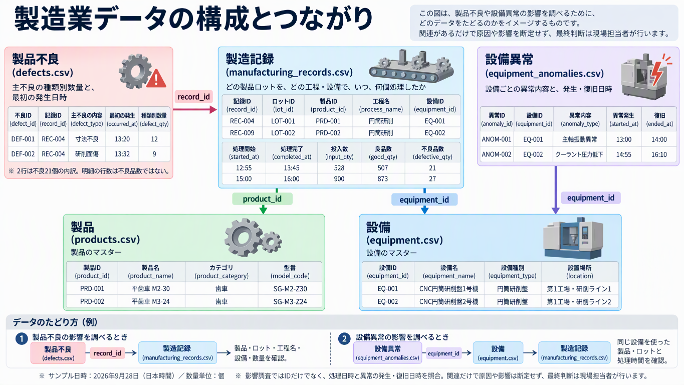
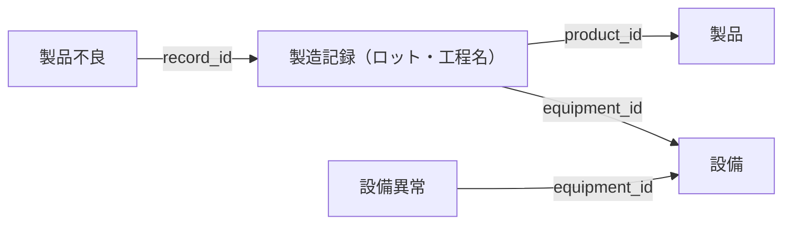

# 演習編：製造現場の影響調査を支援するデータエージェントの作成

## 背景

ある製造業のお客様は、歩留まり（良品率）の改善に向けて、日々、製品不良の原因分析に取り組んでいます。

製品不良や設備異常が見つかった際には、速やかに影響範囲を調査し、必要な対応を判断しなければなりません。特に、次の2つの調査が求められています。

- **製品不良を起点とした調査**：不良が見つかった製品の製造履歴をたどり、関連する工程や設備を確認して、ほかに影響を受けている可能性のあるロットを洗い出す。
- **設備異常を起点とした調査**：異常が見つかった設備で製造した製品・ロットを確認し、再検品が必要な対象を洗い出す。

## 現状の課題

現在、現場の担当者は、Excel で管理された製造記録や品質・設備に関する情報を手作業で突き合わせ、製品・ロット・工程・設備のつながりをたどっています。

複数のデータを確認する必要があるため、影響範囲の特定に時間がかかり、不良や異常が見つかってから対応を判断するまでに時間を要しています。

## 顧客からの要望

> AI を活用して、製品不良や設備異常が見つかった際の影響調査にかかる時間を短縮したいと考えています。
>
> 担当者が自然言語で質問することで、関連する製造記録・製品・ロット・工程・設備の情報を確認し、影響が疑われるロットや再検品が必要な製品を、根拠とともに把握できるようにしてください。

## 演習課題

上記の要望を受けた担当者として、提供された製造業データを確認し、**顧客の要望に応える仕組みを作成してください。**

**顧客の要望を満たせれば、実現手段は問いません。** 使用する機能や構成は自由に選択してください。

1. データの内容と、製品・ロット・工程・設備などの関係を確認してください。
2. 製品不良と設備異常のそれぞれを起点に、影響範囲を調査できるようにしてください。
3. 想定される質問を使って、調査対象と、その判断の根拠となるデータを確認できるか検証してください。

なお、データから確認できる事実と、原因や影響に関する推測は区別してください。作成する仕組みは調査や判断を支援するものであり、最終的な原因の断定や再検品の要否の判断は、現場の担当者が行う想定です。

## 想定される質問

IDを知らない現場担当者が、前の回答を踏まえて順に調査を深めていく質問を想定しています。関連データをたどり、根拠とともに答えられるか確認してください。

1. 不良率が高いロットを教えてください。
2. それらのロットで発生した不良の種類と個数の内訳を教えてください。
3. それらのロットで多く発生している不良と設備異常の関連性を、使用設備と発生時刻をもとに調査してください。

## データの構成

演習では、[製造業データ](./data/02_製造業データ/)にある次の5種類の CSV を使用します。精密部品工場を想定した架空データで、歯車・シャフト・ハウジング・カップリングの製造を扱います。

| データ | ファイル | 件数 | 内容 |
| --- | --- | --- | --- |
| 製品 | [products.csv](./data/02_製造業データ/products.csv) | 20件 | 製品ID・製品名・カテゴリ・型番を管理するマスター |
| 設備 | [equipment.csv](./data/02_製造業データ/equipment.csv) | 20件 | 設備ID・設備名・設備種別・設置場所を管理するマスター |
| 製造記録 | [manufacturing_records.csv](./data/02_製造業データ/manufacturing_records.csv) | 500件 | 製品ロット・工程名・設備・処理日時と、投入数・良品数・不良品数を記録したデータ |
| 製品不良 | [defects.csv](./data/02_製造業データ/defects.csv) | 100件 | 製造記録ごとの主不良の種類別数量と、最初の発生日時を記録した明細 |
| 設備異常 | [equipment_anomalies.csv](./data/02_製造業データ/equipment_anomalies.csv) | 100件 | 設備ごとの異常内容と、異常発生・復旧日時を記録したデータ |

製造期間は2026年9月28日～10月15日で、100ロットそれぞれに5工程の履歴があります。複数の不良があるロット、不良記録がないロット、製造時間帯と重なる異常・重ならない異常を含めています。

以前のサンプルを取り込み済みの場合は、業務テーブル5つを新しい CSV の内容で置き換えてください。同じIDを再利用しているため、既存データへの追記はしないでください。工程マスターは使用せず、製造記録の工程名（`process_name`）を使います。モデル側も工程名を文字列として登録し、旧工程IDと工程エンティティへの接続を除いてください。

質問1では、全期間を対象に**ロット全体の不良率**を比較します。質問2では、不良明細の行数ではなく、種類別数量（`defect_qty`）を集計して内訳を確認します。

### 数量と歩留まり

製造記録には、工程ごとの数量を持たせています。単位はすべて「個」です。

| 列 | 意味 |
| --- | --- |
| `input_qty` | その工程への投入数 |
| `good_qty` | その工程で良品と判定された数 |
| `defective_qty` | その工程で不良と判定された数（同じ個体の重複なし） |

- 手直し・判定保留は扱わず、**投入数＝良品数＋不良品数**とします。
- 不良品は次工程に流さず、**前工程の良品数＝次工程の投入数**とします。
- 工程歩留まりは **良品数合計 ÷ 投入数合計 × 100** です。ロット別歩留まりの単純平均は使いません。
- ロット全体の歩留まりは **最終工程の良品数 ÷ 初工程の投入数 × 100** です。
- ロット全体の不良率は **（初工程の投入数 − 最終工程の良品数）÷ 初工程の投入数 × 100** です。初工程の投入数が0の場合は算出対象外とします。
- 不良記録の件数は不良品数ではありません。複数の不良記録を結合して、同じ製造記録の数量を二重に集計しないようにしてください。

不良明細には、主不良の種類別数量（`defect_qty`）を持たせます。**不良品1個につき主な不良を1種類に分類**し、製造記録ごとに **`defect_qty` の合計＝`defective_qty`** とします。不良品数が0なら明細は作りません。不良内容は原因の確定を意味しません。

不良明細の発生日時は、その主不良の最初の発生時刻です。種類別数量の全数がその時刻に発生したという意味ではありません。

### データのつながり

**製造記録を中心に、共通のIDでデータを関連付けます。**

画像は5種類のデータの構成とつながりを示しています。工程名は製造記録に含まれます。図中のサンプル値は説明用です。詳細は、以下の Mermaid 図と各 CSV を参照してください。

- 製造記録は、`product_id`・`equipment_id`で製品・設備につながります。ロットID（`lot_id`）と工程名（`process_name`）は製造記録に含まれます。
- 製品不良は、`record_id`で製造記録につながります。不良が発生したロットや、使用した設備を確認できます。
- 設備異常は、`equipment_id`で設備につながります。同じ設備を使用した製造記録をたどることで、関連する製品・ロットを確認できます。

影響範囲の調査では、IDによる関連付けに加え、製造記録の処理日時や設備異常の発生・復旧日時を使い、処理の前後関係や時間帯の重なりを確認します。

### 各データのサンプル

各 CSV の先頭5行を抜粋します。以下の日時はすべて **2026年9月28日・日本時間（+09:00）** で、表では時刻のみを記載しています。CSV 全体には複数日の記録があり、ファイルの並び順は全体の日時順とは限りません。

#### 製品

| 製品ID（`product_id`） | 製品名（`product_name`） | カテゴリ（`product_category`） | 型番（`model_code`） |
| --- | --- | --- | --- |
| PRD-001 | 平歯車 M2-30 | 歯車 | SG-M2-Z30 |
| PRD-002 | 平歯車 M3-24 | 歯車 | SG-M3-Z24 |
| PRD-003 | はすば歯車 M2-40 | 歯車 | HG-M2-Z40 |
| PRD-004 | はすば歯車 M3-32 | 歯車 | HG-M3-Z32 |
| PRD-005 | 減速機用ピニオン M1.5-20 | 歯車 | PN-M15-Z20 |

#### 設備

| 設備ID（`equipment_id`） | 設備名（`equipment_name`） | 設備種別（`equipment_type`） | 設置場所（`location`） |
| --- | --- | --- | --- |
| EQ-001 | CNC円筒研削盤1号機 | 円筒研削盤 | 第1工場・研削ライン1 |
| EQ-002 | CNC円筒研削盤2号機 | 円筒研削盤 | 第1工場・研削ライン2 |
| EQ-003 | 自動帯鋸切断機1号機 | 帯鋸切断機 | 第1工場・素材加工エリア |
| EQ-004 | CNC旋盤1号機 | CNC旋盤 | 第1工場・旋削ライン |
| EQ-005 | 三次元測定機1号機 | 三次元測定機 | 品質棟・寸法測定室 |

#### 製造記録

| 記録ID（`record_id`） | ロットID（`lot_id`） | 製品ID（`product_id`） | 工程名（`process_name`） | 設備ID（`equipment_id`） | 処理開始（`started_at`） | 処理完了（`completed_at`） | 投入数（`input_qty`） | 良品数（`good_qty`） | 不良品数（`defective_qty`） |
| --- | --- | --- | --- | --- | --- | --- | --- | --- | --- |
| REC-001 | LOT-001 | PRD-001 | 歯切り | EQ-006 | 08:00 | 09:05 | 550 | 546 | 4 |
| REC-002 | LOT-001 | PRD-001 | 浸炭焼入れ | EQ-007 | 09:25 | 11:15 | 546 | 538 | 8 |
| REC-003 | LOT-001 | PRD-001 | 焼戻し | EQ-008 | 11:35 | 12:35 | 538 | 528 | 10 |
| REC-004 | LOT-001 | PRD-001 | 円筒研削 | EQ-001 | 12:55 | 13:45 | 528 | 507 | 21 |
| REC-005 | LOT-001 | PRD-001 | 寸法検査 | EQ-005 | 14:05 | 14:30 | 507 | 499 | 8 |

このロットの全5工程を通した歩留まりは、499 ÷ 550 × 100 ＝ **90.73%** です。

#### 製品不良

| 不良ID（`defect_id`） | 記録ID（`record_id`） | 主不良の内容（`defect_type`） | 最初の発生（`occurred_at`） | 種類別数量（`defect_qty`） |
| --- | --- | --- | --- | --- |
| DEF-001 | REC-004 | 寸法不良 | 13:20 | 12 |
| DEF-002 | REC-004 | 研削面傷 | 13:32 | 9 |
| DEF-003 | REC-009 | 真円度不良 | 15:30 | 27 |
| DEF-004 | REC-026 | 切断長不足 | 08:17 | 10 |
| DEF-005 | REC-027 | 外径公差外れ | 09:25 | 12 |

`REC-004` の不良品21個は、寸法不良12個と研削面傷9個の内訳です。同じ個体を両方には数えません。

#### 設備異常

| 異常ID（`anomaly_id`） | 設備ID（`equipment_id`） | 異常内容（`anomaly_type`） | 異常発生（`started_at`） | 復旧（`ended_at`） |
| --- | --- | --- | --- | --- |
| ANOM-001 | EQ-001 | 主軸振動異常 | 13:00 | 14:00 |
| ANOM-002 | EQ-002 | クーラント圧力低下 | 14:55 | 16:10 |
| ANOM-003 | EQ-001 | 砥石負荷上昇 | 07:00 | 07:30 |
| ANOM-004 | EQ-002 | 主軸振動異常 | 07:00 | 07:30 |
| ANOM-005 | EQ-007 | 炉温偏差警告 | 09:35 | 11:05 |

## セマンティックモデルの設計

以下は、セマンティックモデルを利用する場合の設計例です。この構成を採用する必要はありません。

モデル名は `manufacturing_semantic_model` とし、`manufacturing_lakehouse` 内の5つのテーブルを使用します。作成操作は、[ハンズオンの「5. セマンティックモデルの作成」](./handson.md#5-セマンティックモデルの作成)を参考にしてください。

### テーブル構成

CSV の列をそのまま使用し、次の役割で整理します。

| テーブル | 役割 | 1行が表すもの | 一意なキー |
| --- | --- | --- | --- |
| `products` | 製品マスター | 1製品 | `product_id` |
| `equipment` | 設備マスター | 1設備 | `equipment_id` |
| `manufacturing_records` | 製造実績 | 1ロットを1工程・1設備で処理した記録 | `record_id` |
| `defects` | 不良の内訳 | 製造記録内の主不良1種類の数量 | `defect_id` |
| `equipment_anomalies` | 設備異常の履歴 | 1件の設備異常 | `anomaly_id` |

ロットと工程は別テーブルにせず、`manufacturing_records` の `lot_id` と `process_name` を使用します。1ロットに複数工程があるため、`lot_id` は一意なキーにはしません。

- ID・名称・分類・工程名・不良内容・異常内容は文字列にします。
- `input_qty`・`good_qty`・`defective_qty`・`defect_qty` は整数にします。
- `started_at`・`completed_at`・`occurred_at`・`ended_at` は日時として扱い、比較時のタイムゾーンをそろえます。

### リレーションシップ

次の4本を、すべて**1対多・単一方向・アクティブ**で設定します。フィルターは1側から多側へ伝わります。

| 1側のテーブル・列 | 多側のテーブル・列 | フィルター方向 |
| --- | --- | --- |
| `products[product_id]` | `manufacturing_records[product_id]` | 製品 → 製造記録 |
| `equipment[equipment_id]` | `manufacturing_records[equipment_id]` | 設備 → 製造記録 |
| `manufacturing_records[record_id]` | `defects[record_id]` | 製造記録 → 不良の内訳 |
| `equipment[equipment_id]` | `equipment_anomalies[equipment_id]` | 設備 → 設備異常 |

`manufacturing_records` と `equipment_anomalies` は、同じ設備に複数の記録があるため、`equipment_id` 同士で直接つなぎません。設備マスターを介して関連付け、時間帯の重なりは検索・クエリで確認します。

### 集計指標（メジャー）

ロット全体の指標と、工程別の延べ数量を区別します。ロットの初工程・最終工程は、行の並び順ではなく処理日時で判定します。

| メジャー名の例 | 定義 |
| --- | --- |
| ロット初工程投入数 | 対象ロットごとに、`started_at` が最も早い製造記録の `input_qty` を取得して合計する |
| ロット最終良品数 | 対象ロットごとに、`completed_at` が最も遅い製造記録の `good_qty` を取得して合計する |
| ロット不良品数 | `[ロット初工程投入数] - [ロット最終良品数]` |
| ロット不良率 | `DIVIDE([ロット不良品数], [ロット初工程投入数])` |
| ロット歩留まり | `DIVIDE([ロット最終良品数], [ロット初工程投入数])` |
| 種類別不良品数 | `SUM(defects[defect_qty])` |
| 工程不良率 | `DIVIDE(SUM(manufacturing_records[defective_qty]), SUM(manufacturing_records[input_qty]))` |

- 比率のメジャーはパーセント表示にします。DAX では100を掛けず、`DIVIDE` の分母が0の場合は空白とします。
- ロット全体の指標は、対象ロットの**全工程**を参照して計算します。工程や設備で絞り込んだ結果を、ロットの初工程・最終工程と取り違えないようにしてください。
- 複数ロットの合計では、各ロットの初工程投入数・最終良品数をそれぞれ合計してから比率を計算します。ロット別の率の単純平均や、全工程の投入数合計は使いません。
- 不良種類で絞り込んだだけでは、製造記録側へフィルターは逆流しません。種類別数量には `defects[defect_qty]` を使い、不良種類別の数量とロット全体の不良品数を混同しないようにします。
- 不良明細や設備異常を結合して、同じ製造記録の投入数・良品数・不良品数を重複集計しないようにしてください。

### 想定質問に対応する調べ方

| 質問 | セマンティックモデルでの確認方法 |
| --- | --- |
| 1. 不良率が高いロット | `manufacturing_records[lot_id]` ごとに `[ロット不良率]` を求め、降順に並べる。製品名や初工程投入数・不良品数も示す |
| 2. 不良の内訳 | 対象の `lot_id` で絞り込み、`defects[defect_type]` ごとに `[種類別不良品数]` を集計する |
| 3. 設備異常との関連性 | 対象ロットの不良明細と製造記録から設備ID・不良発生時刻・製造時間帯を取得し、同じ設備の異常発生・復旧日時と比較する |

質問3では、ロットを選択しても、製造記録から設備マスターを経て設備異常へはフィルターが自動で伝わりません。検索・クエリでは、対象の設備IDと日時条件を設備異常側に明示的に適用してください。関連を確認するためだけに、リレーションシップを一律に双方向へ変更する必要はありません。

不良の最初の発生が異常中かどうかは、同じ設備について **異常発生日時 ≤ 不良発生日時 < 復旧日時** で確認します。同じ設備・時間帯でも原因とは断定せず、その主不良の全数が異常中に発生したとも判断しません。

## オントロジーの設計

以下は、オントロジーを利用する場合の設計例です。この構成を採用する必要はありません。

5種類のデータを、次の5つのエンティティ型と4つのリレーションシップ型で表します。オントロジー名は `manufacturing_ontology` とし、各エンティティを `manufacturing_lakehouse` 内の対応するテーブルにバインドします。作成操作は、[ハンズオンの「7. オントロジーの作成」](./handson.md#7-オントロジーの作成)を参考にしてください。

### エンティティ型

プロパティ名は、CSV の列名をそのまま使用します。

| エンティティ型 | 意味 | バインドするテーブル | エンティティ型キー | キー以外のプロパティ |
| --- | --- | --- | --- | --- |
| `Product` | 製品マスターの1製品 | `products` | `product_id` | `product_name`, `product_category`, `model_code` |
| `Equipment` | 設備マスターの1設備 | `equipment` | `equipment_id` | `equipment_name`, `equipment_type`, `location` |
| `ManufacturingRecord` | 1ロットを1工程・1設備で処理した実績 | `manufacturing_records` | `record_id` | `lot_id`, `product_id`, `process_name`, `equipment_id`, `started_at`, `completed_at`, `input_qty`, `good_qty`, `defective_qty` |
| `Defect` | 製造記録内の主不良の種類別内訳 | `defects` | `defect_id` | `record_id`, `defect_type`, `occurred_at`, `defect_qty` |
| `EquipmentAnomaly` | 設備異常の1イベント | `equipment_anomalies` | `anomaly_id` | `equipment_id`, `anomaly_type`, `started_at`, `ended_at` |

同じロットには複数工程の記録があるため、**製造記録のキーは `lot_id` ではなく `record_id`** にします。ロットと工程は独立したエンティティにせず、`ManufacturingRecord` の `lot_id` と `process_name` で扱います。

### プロパティの型と意味

| 対象 | 型 | 扱い |
| --- | --- | --- |
| ID・名称・分類・工程名・不良内容・異常内容 | 文字列 | IDはエンティティの識別や関係の照合に使用する |
| `input_qty`, `good_qty`, `defective_qty`, `defect_qty` | 整数 | 単位は「個」。不良明細の行数と不良品数を区別する |
| `started_at`, `completed_at`, `occurred_at`, `ended_at` | 日時 | CSV の日本時間（`+09:00`）を保持するか、同じタイムゾーンにそろえて比較する |

- `Defect.defect_type` は不良の内容であり、確定した原因ではありません。
- `Defect.defect_qty` は主不良の種類別数量です。製造記録ごとの合計を `ManufacturingRecord.defective_qty` と一致させます。
- `Defect.occurred_at` は、その主不良の最初の発生時刻です。内訳の全数がその時刻に発生したとは扱いません。
- 不良率や歩留まりはCSVの固定値として追加せず、数量と工程順から集計・計算します。

### リレーションシップ型

以下は、**マッピングテーブルを使用せず、元とターゲットのプロパティを直接照合する**設計です。元からターゲットへの関係はいずれも多対1です。

| 元のエンティティ型 | リレーションシップ名 | ターゲットのエンティティ型 | 元のプロパティ | ターゲットのプロパティ |
| --- | --- | --- | --- | --- |
| `ManufacturingRecord` | `ProducesProduct`（製造する製品） | `Product` | `product_id` | `product_id` |
| `ManufacturingRecord` | `UsesEquipment`（使用する設備） | `Equipment` | `equipment_id` | `equipment_id` |
| `Defect` | `FoundInRecord`（不良が発生した製造記録） | `ManufacturingRecord` | `record_id` | `record_id` |
| `EquipmentAnomaly` | `OccursOnEquipment`（異常が発生した設備） | `Equipment` | `equipment_id` | `equipment_id` |

不良と設備異常を直接結ぶ「原因」のリレーションシップは作りません。**同じ設備につながることと、異常の時間帯が重なることを、調査時に組み合わせて確認**します。

> Graph も作成する場合は、関係の名前・方向の定義に加え、リレーションシップのデータバインドも必要です。[ハンズオンの「9. Graph の作成と確認」](./handson.md#9-graph-の作成と確認)を参考に、Graph に投影する関係も設定してください。

### 想定質問に対応する調べ方

| 質問 | オントロジー上で確認する内容 |
| --- | --- |
| 1. 不良率が高いロット | `ManufacturingRecord` を `lot_id` ごとにまとめ、処理日時で工程順を確認する。初工程の投入数と最終工程の良品数から、ロット全体の不良率を計算する |
| 2. 不良の内訳 | 対象ロットの製造記録にひも付く `Defect` を確認し、ロット・不良種類ごとに `defect_qty` を集計する |
| 3. 設備異常との関連性 | `Defect` → `ManufacturingRecord` → `Equipment` をたどり、同じ設備にひも付く `EquipmentAnomaly` と日時を比較する |

質問3では、次の条件で関連や影響の候補を確認します。期間はすべて **開始時刻を含み、終了時刻を含まない**ものとします。

| 確認したいこと | 同じ設備であることに加えて適用する条件 |
| --- | --- |
| 不良の最初の発生が異常中か | `EquipmentAnomaly.started_at <= Defect.occurred_at < EquipmentAnomaly.ended_at` |
| 製造時間帯が異常と重なるか | `ManufacturingRecord.started_at < EquipmentAnomaly.ended_at` かつ `ManufacturingRecord.completed_at > EquipmentAnomaly.started_at` |

日時条件や不良率の計算は、エンティティとリレーションシップを定義するだけでは自動的に適用されません。データエージェントの指示や検索・クエリで明示してください。不良明細や設備異常を結合するときも、同じ製造記録の数量を重複集計しないようにします。

同じ設備・時間帯に不良と異常があっても、原因と断定はしません。また、不良の最初の発生時刻が異常中でも、`defect_qty` の全数が異常中に発生したとは判断できません。

## 命名規則案

ワークスペースは、[ハンズオン](./handson.md)で作成した自分のワークスペース（例：`fabriciq-handson-yamada`）を引き続き使用します。

営業データのアイテムと区別できるように、製造業の演習で作成するアイテムには、**`manufacturing_`** を接頭辞として付けることを推奨します。各自のワークスペース内で作成するため、受講生同士で同じ名前を使用でき、アイテム名に自分の名前を付ける必要はありません。

| アイテム | 名前の案 |
| --- | --- |
| レイクハウス | `manufacturing_lakehouse` |
| セマンティックモデル | `manufacturing_semantic_model` |
| オントロジー | `manufacturing_ontology` |
| Graph（自動生成） | `manufacturing_ontology_graph_...`（末尾は自動生成） |
| データエージェント（レイクハウス） | `manufacturing_agent` |
| データエージェント（セマンティックモデル） | `manufacturing_agent_semantic` |
| データエージェント（オントロジー） | `manufacturing_agent_ontology` |
| データエージェント（Graph） | `manufacturing_agent_graph` |

使用する構成に応じて、必要なアイテムだけを作成してください。すべてのモデルやデータエージェントを作成する必要はありません。

テーブルは `manufacturing_lakehouse` 内に作成し、CSV の拡張子を除いたファイル名を使用します（例：`products.csv` → `products`、`manufacturing_records.csv` → `manufacturing_records`）。

## 答え合わせ

演習に取り組んだ後に確認してください。以下は、現在の CSV 全期間を対象とした回答例です。質問1では不良率の上位3ロットを取り上げ、質問2・3もその3ロットを対象にします。使用する手段や回答の表現が異なっていても、数値と根拠が一致していれば問題ありません。

### 質問1：不良率が高いロット

ロット全体の不良率を計算すると、上位3ロットは次のとおりです。不良率は小数点以下2桁に丸めています。

| 順位 | ロット | 製品名 | 初工程の投入数 | 最終工程の良品数 | ロット全体の不良品数 | 不良率 |
| --- | --- | --- | ---: | ---: | ---: | ---: |
| 1 | LOT-007 | 段付きシャフト φ30 | 950 | 752 | 198 | 20.84% |
| 2 | LOT-070 | ローター軸 φ40 | 900 | 730 | 170 | 18.89% |
| 3 | LOT-024 | はすば歯車 M3-32 | 950 | 790 | 160 | 16.84% |

例えば、`LOT-007` は **（950 − 752）÷ 950 × 100 ≒ 20.84%** です。各工程の投入数を足した値を分母にしないようにしてください。

### 質問2：対象ロットの不良の内訳

製造記録と不良明細を `record_id` で関連付け、対象ロットごとに `defect_qty` を集計します。

| ロット | 研削面傷 | 浸炭深さ不足 | 合計 |
| --- | ---: | ---: | ---: |
| LOT-007 | 180 | 18 | 198 |
| LOT-070 | 170 | 0 | 170 |
| LOT-024 | 160 | 0 | 160 |

単位は「個」です。表の0個は対応する不良明細がないことを表します。この3ロットには、上記以外の不良種類はありません。

共通して多い不良は **研削面傷** で、3ロット合計では **510個** です。全ロットでは研削面傷が **685個**、次に多い真円度不良が **267個** あります。全体の合計を、各ロットの数量として繰り返し表示しないようにしてください。

### 質問3：研削面傷と設備異常の関連性

3ロットの研削面傷は、いずれも**円筒研削工程・CNC円筒研削盤1号機（`EQ-001`）**で発生しています。同じ設備では、次のクーラント圧力低下が記録されています。日時はすべて日本時間（`+09:00`）です。

| ロット | 製造記録 | 不良明細 | 研削面傷の最初の発生日時 | 設備異常 | 異常期間（発生と同日） |
| --- | --- | --- | --- | --- | --- |
| LOT-007 | REC-034 | DEF-096 | 2026-09-29 15:24 | ANOM-089 | 15:00～15:40 |
| LOT-070 | REC-349 | DEF-079 | 2026-10-12 15:09 | ANOM-081 | 14:50～15:25 |
| LOT-024 | REC-119 | DEF-035 | 2026-10-02 12:18 | ANOM-075 | 12:05～12:45 |

いずれも、同じ設備で **異常発生日時 ≤ 不良の最初の発生日時 < 復旧日時** が成立しています。各ロットの円筒研削の製造時間帯も、対応する異常期間と重なっています。

回答では、例えば次のように事実と推測を分けます。

> 不良率上位3ロットでは研削面傷が多く、共通してCNC円筒研削盤1号機を使用しています。各ロットの研削面傷の最初の発生時刻は、同設備のクーラント圧力低下の期間内にあります。このため、クーラント圧力低下は研削面傷との関連が疑われる調査候補です。ただし、このデータだけで原因とは断定できません。

`defect_qty` は製造記録内の種類別数量であり、**510個すべてが異常期間内に発生したとは判断できません**。設備の点検記録や加工条件などを追加確認し、原因や再検品の要否は現場で判断します。

### 確認ポイント

- ロット全体の不良率と、特定工程だけの不良率を区別できていること。
- ロットごとの不良内訳の合計が、そのロットの不良品数と一致すること。
- 不良と設備異常を、同じ設備IDと日時条件の両方で照合していること。
- 関連するデータのIDや日時を示し、原因や影響の断定を避けていること。