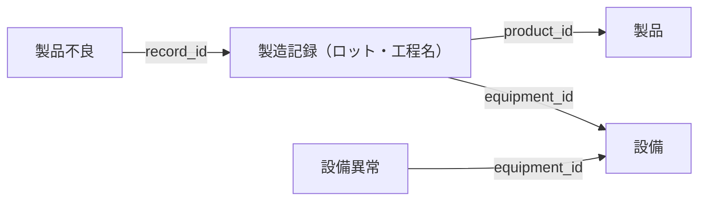

# 演習編：製造現場の影響調査を支援するデータエージェントの作成

## 背景

ある製造業のお客様は、歩留まり（良品率）の改善に向けて、日々、製品不良の原因分析に取り組んでいます。

製品不良や設備異常が見つかった際には、速やかに影響範囲を調査し、必要な対応を判断しなければなりません。特に、次の2つの調査が求められています。

- **製品不良を起点とした調査**：不良が見つかった製品の製造履歴をたどり、関連する工程や設備を確認して、ほかに影響を受けている可能性のあるロットを洗い出す。
- **設備異常を起点とした調査**：異常が見つかった設備で製造した製品・ロットを確認し、再検品が必要な対象を洗い出す。

## 現状の課題

現在、現場の担当者は、Excel で管理された製造記録や品質・設備に関する情報を手作業で突き合わせ、製品・ロット・工程・設備のつながりをたどっています。

複数のデータを確認する必要があるため、影響範囲の特定に時間がかかり、不良や異常が見つかってから対応を判断するまでに時間を要しています。

## 顧客からの要望

> AI を活用して、製品不良や設備異常が見つかった際の影響調査にかかる時間を短縮したいと考えています。
>
> 担当者が自然言語で質問することで、関連する製造記録・製品・ロット・工程・設備の情報を確認し、影響が疑われるロットや再検品が必要な製品を、根拠とともに把握できるようにしてください。

## 演習課題

上記の要望を受けた担当者として、提供された製造業データを確認し、**顧客の要望に応えるデータエージェントを作成してください。**

1. データの内容と、製品・ロット・工程・設備などの関係を確認してください。
2. 製品不良と設備異常のそれぞれを起点に、影響範囲を調査できるデータエージェントを作成してください。
3. 作成したデータエージェントに質問し、調査対象と、その判断の根拠となるデータを確認できるか検証してください。

なお、データから確認できる事実と、原因や影響に関する推測は区別してください。データエージェントは調査や判断を支援するものであり、最終的な原因の断定や再検品の要否の判断は、現場の担当者が行う想定です。

## 想定される質問

IDを知らない現場担当者が、前の回答を踏まえて順に調査を深めていく質問を想定しています。関連データをたどり、根拠とともに答えられるか確認してください。

1. 不良率が高いロットを教えてください。
2. それらのロットで発生した不良の種類と個数の内訳を教えてください。
3. それらのロットで多く発生している不良と設備異常の関連性を、使用設備と発生時刻をもとに調査してください。

## データの構成

演習では、[製造業データ](./data/02_製造業データ/)にある次の5種類の CSV を使用します。精密部品工場を想定した架空データで、歯車・シャフト・ハウジング・カップリングの製造を扱います。

| データ | ファイル | 件数 | 内容 |
| --- | --- | --- | --- |
| 製品 | [products.csv](./data/02_製造業データ/products.csv) | 20件 | 製品ID・製品名・カテゴリ・型番を管理するマスター |
| 設備 | [equipment.csv](./data/02_製造業データ/equipment.csv) | 20件 | 設備ID・設備名・設備種別・設置場所を管理するマスター |
| 製造記録 | [manufacturing_records.csv](./data/02_製造業データ/manufacturing_records.csv) | 500件 | 製品ロット・工程名・設備・処理日時と、投入数・良品数・不良品数を記録したデータ |
| 製品不良 | [defects.csv](./data/02_製造業データ/defects.csv) | 100件 | 製造記録ごとの主不良の種類別数量と、最初の発生日時を記録した明細 |
| 設備異常 | [equipment_anomalies.csv](./data/02_製造業データ/equipment_anomalies.csv) | 100件 | 設備ごとの異常内容と、異常発生・復旧日時を記録したデータ |

製造期間は2026年9月28日～10月15日で、100ロットそれぞれに5工程の履歴があります。複数の不良があるロット、不良記録がないロット、製造時間帯と重なる異常・重ならない異常を含めています。

以前のサンプルを取り込み済みの場合は、業務テーブル5つを新しい CSV の内容で置き換えてください。同じIDを再利用しているため、既存データへの追記はしないでください。工程マスターは使用せず、製造記録の工程名（`process_name`）を使います。モデル側も工程名を文字列として登録し、旧工程IDと工程エンティティへの接続を除いてください。

質問1では、全期間を対象に**ロット全体の不良率**を比較します。質問2では、不良明細の行数ではなく、種類別数量（`defect_qty`）を集計して内訳を確認します。

### 数量と歩留まり

製造記録には、工程ごとの数量を持たせています。単位はすべて「個」です。

| 列 | 意味 |
| --- | --- |
| `input_qty` | その工程への投入数 |
| `good_qty` | その工程で良品と判定された数 |
| `defective_qty` | その工程で不良と判定された数（同じ個体の重複なし） |

- 手直し・判定保留は扱わず、**投入数＝良品数＋不良品数**とします。
- 不良品は次工程に流さず、**前工程の良品数＝次工程の投入数**とします。
- 工程歩留まりは **良品数合計 ÷ 投入数合計 × 100** です。ロット別歩留まりの単純平均は使いません。
- ロット全体の歩留まりは **最終工程の良品数 ÷ 初工程の投入数 × 100** です。
- ロット全体の不良率は **（初工程の投入数 − 最終工程の良品数）÷ 初工程の投入数 × 100** です。初工程の投入数が0の場合は算出対象外とします。
- 不良記録の件数は不良品数ではありません。複数の不良記録を結合して、同じ製造記録の数量を二重に集計しないようにしてください。

不良明細には、主不良の種類別数量（`defect_qty`）を持たせます。**不良品1個につき主な不良を1種類に分類**し、製造記録ごとに **`defect_qty` の合計＝`defective_qty`** とします。不良品数が0なら明細は作りません。不良内容は原因の確定を意味しません。

不良明細の発生日時は、その主不良の最初の発生時刻です。種類別数量の全数がその時刻に発生したという意味ではありません。

### データのつながり

**製造記録を中心に、共通のIDでデータを関連付けます。**

画像は工程マスターを分けていた旧構成のイメージで、図中のサンプル値は説明用です。現在は工程名を製造記録に統合しています。実際の5種類の構成・項目・値は、以下の Mermaid 図と各 CSV を参照してください。

- 製造記録は、`product_id`・`equipment_id`で製品・設備につながります。ロットID（`lot_id`）と工程名（`process_name`）は製造記録に含まれます。
- 製品不良は、`record_id`で製造記録につながります。不良が発生したロットや、使用した設備を確認できます。
- 設備異常は、`equipment_id`で設備につながります。同じ設備を使用した製造記録をたどることで、関連する製品・ロットを確認できます。

影響範囲の調査では、IDによる関連付けに加え、製造記録の処理日時や設備異常の発生・復旧日時を使い、処理の前後関係や時間帯の重なりを確認します。

### 各データのサンプル

各 CSV の先頭5行を抜粋します。以下の日時はすべて **2026年9月28日・日本時間（+09:00）** で、表では時刻のみを記載しています。CSV 全体には複数日の記録があり、ファイルの並び順は全体の日時順とは限りません。

#### 製品

| 製品ID（`product_id`） | 製品名（`product_name`） | カテゴリ（`product_category`） | 型番（`model_code`） |
| --- | --- | --- | --- |
| PRD-001 | 平歯車 M2-30 | 歯車 | SG-M2-Z30 |
| PRD-002 | 平歯車 M3-24 | 歯車 | SG-M3-Z24 |
| PRD-003 | はすば歯車 M2-40 | 歯車 | HG-M2-Z40 |
| PRD-004 | はすば歯車 M3-32 | 歯車 | HG-M3-Z32 |
| PRD-005 | 減速機用ピニオン M1.5-20 | 歯車 | PN-M15-Z20 |

#### 設備

| 設備ID（`equipment_id`） | 設備名（`equipment_name`） | 設備種別（`equipment_type`） | 設置場所（`location`） |
| --- | --- | --- | --- |
| EQ-001 | CNC円筒研削盤1号機 | 円筒研削盤 | 第1工場・研削ライン1 |
| EQ-002 | CNC円筒研削盤2号機 | 円筒研削盤 | 第1工場・研削ライン2 |
| EQ-003 | 自動帯鋸切断機1号機 | 帯鋸切断機 | 第1工場・素材加工エリア |
| EQ-004 | CNC旋盤1号機 | CNC旋盤 | 第1工場・旋削ライン |
| EQ-005 | 三次元測定機1号機 | 三次元測定機 | 品質棟・寸法測定室 |

#### 製造記録

| 記録ID（`record_id`） | ロットID（`lot_id`） | 製品ID（`product_id`） | 工程名（`process_name`） | 設備ID（`equipment_id`） | 処理開始（`started_at`） | 処理完了（`completed_at`） | 投入数（`input_qty`） | 良品数（`good_qty`） | 不良品数（`defective_qty`） |
| --- | --- | --- | --- | --- | --- | --- | --- | --- | --- |
| REC-001 | LOT-001 | PRD-001 | 歯切り | EQ-006 | 08:00 | 09:05 | 550 | 546 | 4 |
| REC-002 | LOT-001 | PRD-001 | 浸炭焼入れ | EQ-007 | 09:25 | 11:15 | 546 | 538 | 8 |
| REC-003 | LOT-001 | PRD-001 | 焼戻し | EQ-008 | 11:35 | 12:35 | 538 | 528 | 10 |
| REC-004 | LOT-001 | PRD-001 | 円筒研削 | EQ-001 | 12:55 | 13:45 | 528 | 507 | 21 |
| REC-005 | LOT-001 | PRD-001 | 寸法検査 | EQ-005 | 14:05 | 14:30 | 507 | 499 | 8 |

このロットの全5工程を通した歩留まりは、499 ÷ 550 × 100 ＝ **90.73%** です。

#### 製品不良

| 不良ID（`defect_id`） | 記録ID（`record_id`） | 主不良の内容（`defect_type`） | 最初の発生（`occurred_at`） | 種類別数量（`defect_qty`） |
| --- | --- | --- | --- | --- |
| DEF-001 | REC-004 | 寸法不良 | 13:20 | 12 |
| DEF-002 | REC-004 | 研削面傷 | 13:32 | 9 |
| DEF-003 | REC-009 | 真円度不良 | 15:30 | 27 |
| DEF-004 | REC-026 | 切断長不足 | 08:17 | 10 |
| DEF-005 | REC-027 | 外径公差外れ | 09:25 | 12 |

`REC-004` の不良品21個は、寸法不良12個と研削面傷9個の内訳です。同じ個体を両方には数えません。

#### 設備異常

| 異常ID（`anomaly_id`） | 設備ID（`equipment_id`） | 異常内容（`anomaly_type`） | 異常発生（`started_at`） | 復旧（`ended_at`） |
| --- | --- | --- | --- | --- |
| ANOM-001 | EQ-001 | 主軸振動異常 | 13:00 | 14:00 |
| ANOM-002 | EQ-002 | クーラント圧力低下 | 14:55 | 16:10 |
| ANOM-003 | EQ-001 | 砥石負荷上昇 | 07:00 | 07:30 |
| ANOM-004 | EQ-002 | 主軸振動異常 | 07:00 | 07:30 |
| ANOM-005 | EQ-007 | 炉温偏差警告 | 09:35 | 11:05 |

## 命名規則案

ワークスペースは、[ハンズオン](./handson.md)で作成した自分のワークスペース（例：`fabriciq-handson-yamada`）を引き続き使用します。

営業データのアイテムと区別できるように、製造業の演習で作成するアイテムには、**`manufacturing_`** を接頭辞として付けることを推奨します。各自のワークスペース内で作成するため、受講生同士で同じ名前を使用でき、アイテム名に自分の名前を付ける必要はありません。

| アイテム | 名前の案 |
| --- | --- |
| レイクハウス | `manufacturing_lakehouse` |
| セマンティックモデル | `manufacturing_semantic_model` |
| オントロジー | `manufacturing_ontology` |
| Graph（自動生成） | `manufacturing_ontology_graph_...`（末尾は自動生成） |
| データエージェント（レイクハウス） | `manufacturing_agent` |
| データエージェント（セマンティックモデル） | `manufacturing_agent_semantic` |
| データエージェント（オントロジー） | `manufacturing_agent_ontology` |
| データエージェント（Graph） | `manufacturing_agent_graph` |

使用する構成に応じて、必要なアイテムだけを作成してください。すべてのモデルやデータエージェントを作成する必要はありません。

テーブルは `manufacturing_lakehouse` 内に作成し、CSV の拡張子を除いたファイル名を使用します（例：`products.csv` → `products`、`manufacturing_records.csv` → `manufacturing_records`）。