# ハンズオン

受講生向けの操作手順です。環境・権限の事前設定は、主催者が[事前準備](./preparation.md)に従って行います。

## 0. ハンズオンで使うデータの確認

操作を始める前に、[営業データ](./data/01_営業データ/)の内容を確認します。営業案件を管理する「案件一覧」と、案件に対する営業活動を記録する「営業報告」の2つの CSV を使用します。

| ファイル | 内容 | データ行数（ヘッダーを除く） | 列数 |
| --- | --- | --- | --- |
| [deals.csv](./data/01_営業データ/deals.csv) | 案件一覧。顧客・案件名・担当者・進捗・金額などを管理 | 100行 | 85列 |
| [sales_reports.csv](./data/01_営業データ/sales_reports.csv) | 営業報告。報告日・報告者・対象案件・活動の目的などを記録 | 100行 | 28列 |

以下は、それぞれの CSV の**ヘッダーを除く先頭5行**です。列数が多いため、説明に使用する主要な列だけを抜粋しています。行はファイルの並び順のままで、日付順には並べ替えていません。

### 案件一覧のサンプル

1行が1件の案件を表します。

| 案件番号（`inquiry_no`） | 顧客名（`customer_name`） | 案件名（`deal_name`） | 営業担当者（`sales_rep`） | 案件ステータス（`deal_status`） | 受注規模額（`order_scale_amt`） |
| --- | --- | --- | --- | --- | --- |
| DM0000001 | 中央電設株式会社 | 物流倉庫受変電設備更新案件 | 佐藤 恵 | 見積提出 | 3400000 |
| DM0000002 | 新星電機株式会社 | 複合商業施設計装設備工事案件 | 日立 二郎 | 打合せ・プレゼン | 4700000 |
| DM0000003 | 東北施設株式会社 | 生産工場空調設備更新案件 | 鈴木 健 | 受注 | 6100000 |
| DM0000004 | 未来都市設備株式会社 | 研究棟省エネ改修案件 | 日立 花子 | 見積提出 | 7500000 |
| DM0000005 | 栄和工業株式会社 | オフィスビル給排水設備工事案件 | 佐藤 恵 | 打合せ・プレゼン | 8800000 |

- `inquiry_no` は案件を識別する番号です。営業報告と関連付けるキーになります。
- `customer_name` と `deal_name` から、「どの顧客の、どの案件か」を確認できます。
- `sales_rep` は営業担当者、`deal_status` は案件の進捗です。先頭5行には「見積提出」「打合せ・プレゼン」「受注」が含まれています。
- `order_scale_amt` は受注規模額です。受注前の案件にも値があるため、確定した受注金額として集計しないように注意します。CSV には、これとは別に受注金額の `order_amt` や売上金額の `sales_amt` もあります。

たとえば `DM0000003` は、鈴木 健さんが担当する東北施設株式会社の「生産工場空調設備更新案件」で、ステータスは「受注」、受注規模額は `6100000` です。

### 営業報告のサンプル

1行が1件の営業報告を表します。同じ案件に対して複数の報告を記録できます。

| 報告番号（`record_no`） | 報告日（`report_date`） | 案件番号（`inquiry_no`） | 報告者（`reporter`） | 報告分類（`category`） | 活動の目的（`purpose`） |
| --- | --- | --- | --- | --- | --- |
| 4801 | 2025-07-21 | DM0000005 | 佐藤 恵 | 見積 | 仕様確認 |
| 4802 | 2025-12-01 | DM0000017 | 鈴木 健 | 受注 | キックオフ実施 |
| 4803 | 2025-06-07 | DM0000049 | 高橋 愛 | 受注 | 受注報告 |
| 4804 | 2026-01-16 | DM0000021 | 佐藤 恵 | 見積 | 見積提出 |
| 4805 | 2025-11-10 | DM0000063 | 鈴木 健 | 受注 | キックオフ実施 |

- `record_no` は営業報告を識別する番号です。案件番号とは異なります。
- `report_date` と `reporter` は、「いつ、誰が報告したか」を表します。
- `inquiry_no` は報告の対象となる案件番号です。案件一覧の同じ番号を参照します。
- `category` は報告の分類、`purpose` は活動の目的です。案件一覧の `deal_status` とは別の項目として扱います。

たとえば報告番号 `4801` は、佐藤 恵さんが `2025-07-21` に案件 `DM0000005` について記録した、「仕様確認」を目的とする「見積」分類の報告です。

### 2つのデータの関係と確認ポイント

案件一覧と営業報告は、共通の **`inquiry_no`（案件番号）** で関連付けます。関係は **案件一覧の1件に対して、営業報告が複数件になり得る「1対多」** です。

上のサンプルでは、案件一覧の5行目と営業報告の1行目が `DM0000005` でつながります。この番号を使うことで、「栄和工業株式会社のオフィスビル給排水設備工事案件に、どのような営業活動が記録されているか」を確認できます。

ハンズオンに進む前に、次の点を確認してください。

1. 案件一覧と営業報告では、1行が表す対象が異なること。
2. 2つのデータは行番号ではなく、`inquiry_no` で関連付けること。
3. 案件の金額と営業報告の件数を区別すること。同じ案件に複数の報告があるため、関連付けた結果の行数だけで案件数を数えたり、案件の金額を重複して合計したりしないようにします。

### 質問と回答のサンプル（9件）

このデータで確認できる内容を、質問と回答の組み合わせで見ておきます。以下は、先頭5行だけではなく、**案件一覧100行・営業報告100行の全体**から求めた回答例です。後のデータエージェントの演習でも、回答を元データと照合するために使用できます。エージェントが必ずこのとおり回答することを保証するものではありません。

集計では、**受注済み＝`deal_status` が「受注」**、**受注金額＝`order_amt`（追加受注を含めない金額）** とします。金額は CSV の値のまま記載し、通貨・単位は業務上の定義と照合してください。

| No. | 質問のサンプル | 回答例 |
| --- | --- | --- |
| 1 | 営業部門ごとの案件数を教えて。 | 営業1課：40件、営業2課：40件、営業3課：20件。 |
| 2 | 案件ステータスごとの件数を教えて。 | 見積提出：37件、打合せ・プレゼン：36件、受注：18件、失注：9件。 |
| 3 | 受注済み案件の受注金額の合計はいくら？ | 183,800,000（受注済み18件の合計）。 |
| 4 | 案件番号DM0000001の顧客名と案件名を教えて。 | 顧客名：中央電設株式会社。案件名：物流倉庫受変電設備更新案件。 |
| 5 | 報告番号4801は、いつ、誰が、何の目的で記録した？ | 2025-07-21に、佐藤 恵さんが「仕様確認」を目的に記録しています。 |
| 6 | 案件番号DM0000001には、どのような営業報告がある？ | 2件。報告番号4813：仕様確認、報告番号4887：変更契約協議。 |
| 7 | 営業報告が1件もない案件は何件ある？ | 30件。 |
| 8 | 「納期調整」の報告がある受注済み案件と、その受注金額を教えて。 | 2件。`DM0000017`：6,800,000、`DM0000024`：16,400,000（合計23,200,000）。 |
| 9 | 佐藤さんが担当している案件を教えて？ | 佐藤 恵さんの担当は20件。案件番号：`DM0000001`、`DM0000005`、`DM0000011`、`DM0000015`、`DM0000021`、`DM0000025`、`DM0000031`、`DM0000035`、`DM0000041`、`DM0000045`、`DM0000051`、`DM0000055`、`DM0000061`、`DM0000065`、`DM0000071`、`DM0000075`、`DM0000081`、`DM0000085`、`DM0000091`、`DM0000095`。 |

特に、No.7 は案件一覧と営業報告を照合し、報告がない案件を探す質問です。No.8 は、営業報告の **活動の目的（`purpose`）** と、案件一覧の **案件ステータス・受注金額** を組み合わせる必要があります。どちらも **`inquiry_no` で関連付け、同じ案件を重複して数えない**ことが確認ポイントです。

No.9 の「佐藤さん」は、このデータでは「佐藤 恵」さんに該当します。担当案件は、営業報告の記録者（`reporter`）ではなく、案件一覧の **営業担当（`sales_rep`）** で絞り込みます。

## 1. ワークスペースの作成

各受講生が自分のワークスペースを作成し、主催者が用意した共有 Fabric 容量へ割り当てます。

### 使用する情報

主催者から、次の情報を受け取ってください。

- 使用するアカウントとテナント
- 使用する共有 Fabric 容量名

### 操作手順

ワークスペース名は、末尾に自分の名前をローマ字で付けます（例：山田さんは `fabriciq-handson-yamada`）。同姓の受講生がいる場合は、`fabriciq-handson-taro-yamada` のように名前も含め、主催者と確認して重複しない表記にしてください。

1. 主催者指定のアカウントで [Microsoft Fabric](https://app.fabric.microsoft.com/) にサインインし、指定されたテナントを選択します。
2. 左側の **ワークスペース（Workspaces）** を開き、一覧の下部にある **新しいワークスペース（New workspace）** を選択します。

   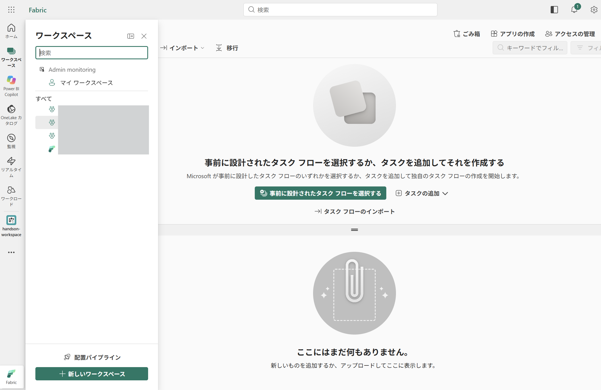

3. **ワークスペースの作成** 画面の **名前** に、自分の名前を付けたワークスペース名（例：`fabriciq-handson-yamada`）を入力します。続けて、画面下部の **詳細** を展開します。

   > 画像の `handson-workspace` は表示例です。実際には、上記の命名ルールに従って自分のワークスペース名を入力してください。

   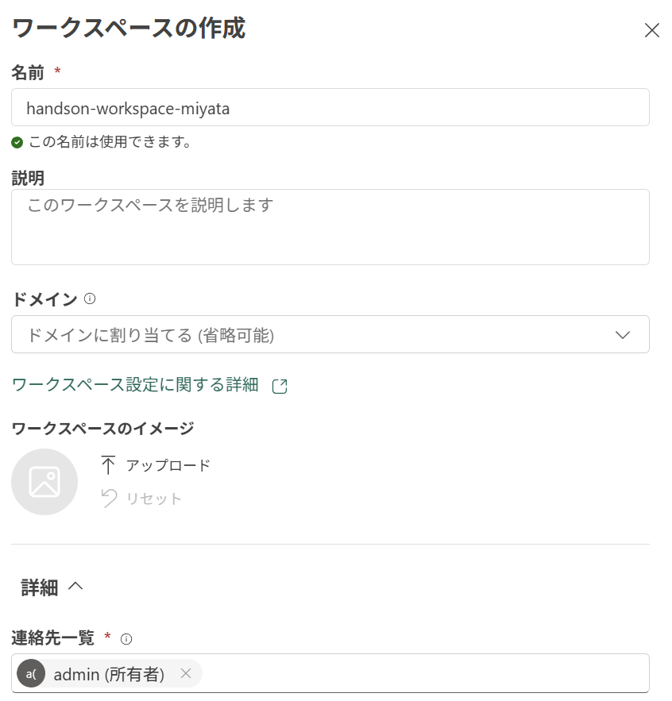

4. **ワークスペースの種類（Workspace type）** で **Fabric** を選択します。Power BI Pro、Premium Per User（PPU）、Fabric 評価版ではなく、主催者が用意した Fabric 容量を使用します。

   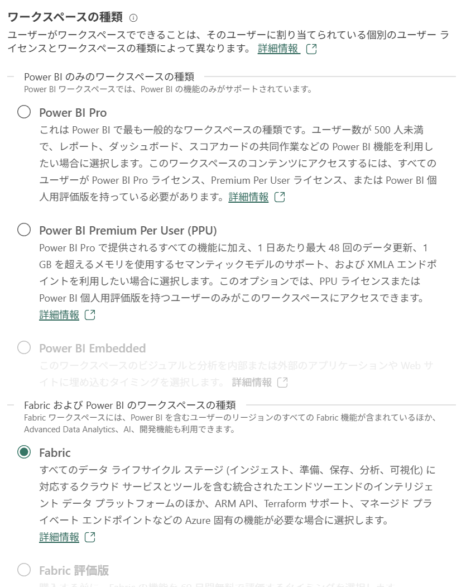

5. 容量を選択する **詳細** のドロップダウンで、主催者指定の **Fabric 容量** を選び、**適用** を選択してワークスペースを作成します。その他の設定は変更不要です。作成者には、そのワークスペースの **Admin（管理者）** が自動的に付与されます。

   > 画像の容量名 `fabrichandson0929 - Central US` は表示例です。実際には、主催者から案内された容量名を選択してください。

   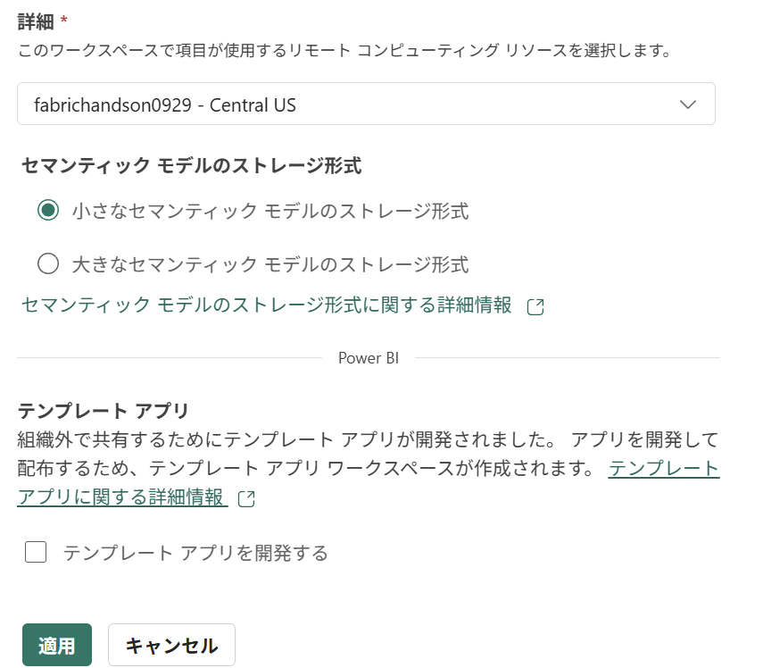

6. 作成したワークスペースの設定を開き、割り当て先が主催者指定の容量になっていることを確認します。作成時に容量を指定しなかった場合や変更する場合は、**ワークスペースの種類（Workspace type）→ 編集（Edit）** から **Fabric** と対象の容量を選択し、適用してください。

以降の演習は、自分で作成したワークスペース内で行います。接続先のレイクハウスやモデルを選ぶ際も、自分のワークスペース内のアイテムを指定してください。

### 演習アイテムの名前

以降の演習で作成するアイテムには、次の名前を使用します。作成先が各自のワークスペースであれば、受講生同士で同じ名前を使用できます。アイテム名に自分の名前を付ける必要はありません。

| アイテム | 名前 |
| --- | --- |
| レイクハウス | `handson_lakehouse` |
| セマンティックモデル（営業） | `sales_semantic_model` |
| オントロジー（営業） | `sales_ontology` |
| Graph（営業・自動生成） | `sales_ontology_graph_...`（末尾は自動生成） |
| データエージェント（レイクハウス） | `sales_agent` |
| データエージェント（セマンティックモデル） | `sales_agent_semantic` |
| データエージェント（オントロジー） | `sales_agent_ontology` |
| データエージェント（Graph） | `sales_agent_graph` |

テーブルは自分のレイクハウス内に作成します。

### アクセス権の注意

受講生全員のグループや他の受講生を、ワークスペースのロールに追加しないでください。アイテムの個別共有も含め、他の受講生にアクセス権を付与しないでください。

### 作成・容量の選択ができない場合

主催者に、使用するアカウント・テナント、ワークスペース作成の許可と、使用する Fabric 容量の Contributor 権限を確認してもらってください。グループ経由で許可している場合は、そのグループへの所属も確認します。容量は主催者と同じテナントのものを使用します。権限の変更後は、Fabric へ再サインインしてください。

アイテムを作成できない場合は、使用する Fabric 容量の稼働状態・割り当てと、対象アイテムのテナント設定も主催者に確認してもらってください。

出典：[ワークスペースの作成・容量への割り当て](https://learn.microsoft.com/ja-jp/fabric/fundamentals/create-workspaces)、[容量の割り当て権限](https://learn.microsoft.com/ja-jp/fabric/governance/onelake-catalog-capacities#manage-capacity-settings)。

## 2. レイクハウスの作成

演習で使用する CSV データを取り込むために、自分のワークスペース内にレイクハウス **`handson_lakehouse`** を作成します。各自のワークスペースが異なれば、受講生全員が同じレイクハウス名を使用できます。

### 操作手順

1. 前の手順で作成した自分のワークスペースを開き、画面上部の **新しい項目（New item）** を選択します。

   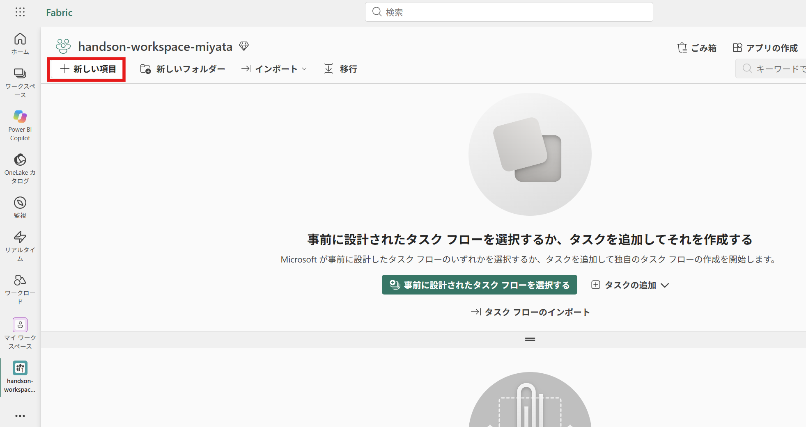

2. **新しい項目** の検索欄に `lake` と入力し、**レイクハウス（Lakehouse）** を選択します。**レイクハウスのサンプル** ではなく、通常の **レイクハウス** を選んでください。

   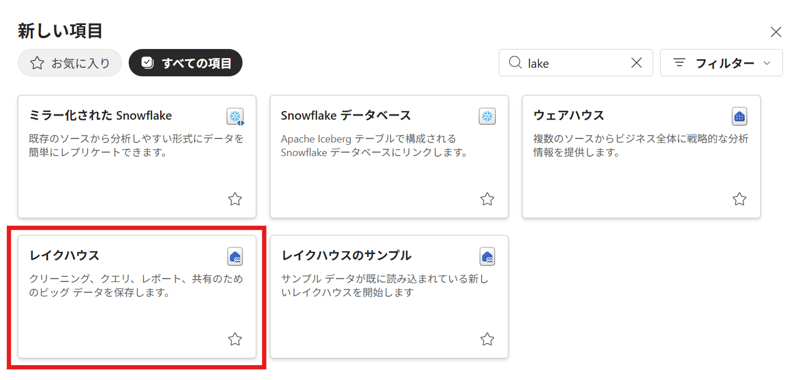

3. **新しいレイクハウス** 画面で、次の内容を設定します。

   | 項目 | 設定内容 |
   | --- | --- |
   | 名前 | `handson_lakehouse` |
   | 場所 | 自分で作成したワークスペース（例：`fabriciq-handson-yamada`） |
   | レイクハウス スキーマ | 画像と同じく、チェックを入れたままにします |

   > レイクハウス名は画像と同じ `handson_lakehouse` を使用します。画像のワークスペース名 `handson-workspace-miyata` は表示例です。場所は自分のワークスペースを選択してください。

   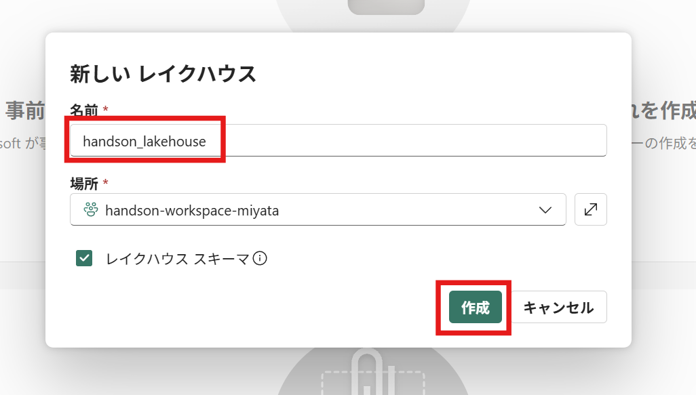

4. **作成（Create）** を選択し、レイクハウスの作成が完了するまで待ちます。
5. レイクハウスの画面が開いたら、名前が **`handson_lakehouse`** であることと、エクスプローラーに **Tables（テーブル）** と **Files（ファイル）** が表示されることを確認します。ワークスペースの一覧に戻った場合も、自分のワークスペース内に `handson_lakehouse` が作成されていることを確認してください。

この段階ではレイクハウスは空の状態です。以降の演習では、このレイクハウスへデータを取り込みます。

## 3. データの読み込み

営業データの2つの CSV を `handson_lakehouse` にアップロードし、それぞれをテーブルとして読み込みます。

**Files へのアップロード** と **Tables への読み込み** は別の操作です。Files は元の CSV を保存する場所で、Tables は分析に使用する Delta テーブルを管理する場所です。ファイルをアップロードしただけでは、テーブルは作成されません。

### 使用するファイル

次の2ファイルを、操作する PC に保存しておいてください。

| ファイル | 内容 | 読み込み先テーブル |
| --- | --- | --- |
| [deals.csv](./data/01_営業データ/deals.csv) | 案件一覧 | `dbo.deals` |
| [sales_reports.csv](./data/01_営業データ/sales_reports.csv) | 営業報告 | `dbo.sales_reports` |

### CSV ファイルのアップロード

1. 自分のワークスペースの **`handson_lakehouse`** を開きます。左側のエクスプローラーで **Files** の **…** メニューを開き、**アップロード → ファイルのアップロード** を選択します。

   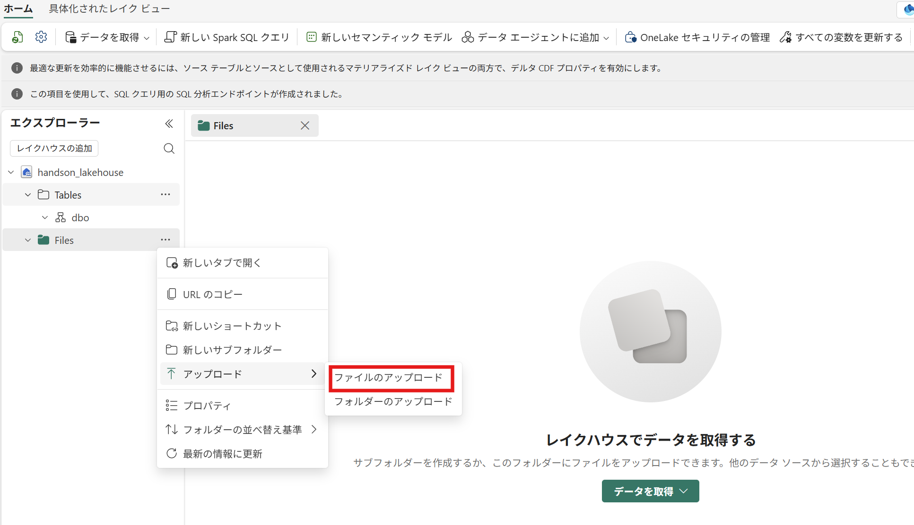

2. **ファイルのアップロード** 画面で、フォルダーアイコンから保存済みの2つの CSV を選択します。選択欄に **`deals.csv`** と **`sales_reports.csv`** が表示され、アップロード先が自分のワークスペースの **`handson_lakehouse/Files/`** になっていることを確認し、**アップロード** を選択します。

   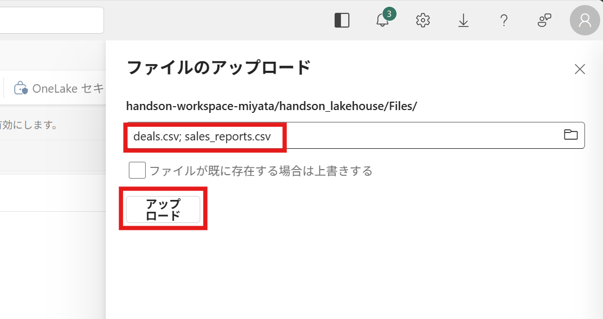

   > 初回は「ファイルが既に存在する場合は上書きする」にチェックを入れる必要はありません。画像のワークスペース名は表示例です。自分のワークスペースが選択されていることを確認してください。

3. アップロードが完了したら、**Files** の一覧に2つの CSV が表示されることを確認します。表示されない場合は、Files の **… → 最新の情報に更新** を選択します。

### CSV を新しいテーブルに読み込む

1. Files の一覧で **`deals.csv`** のメニューを開き、**テーブルに読み込む → 新しいテーブル** を選択します。

   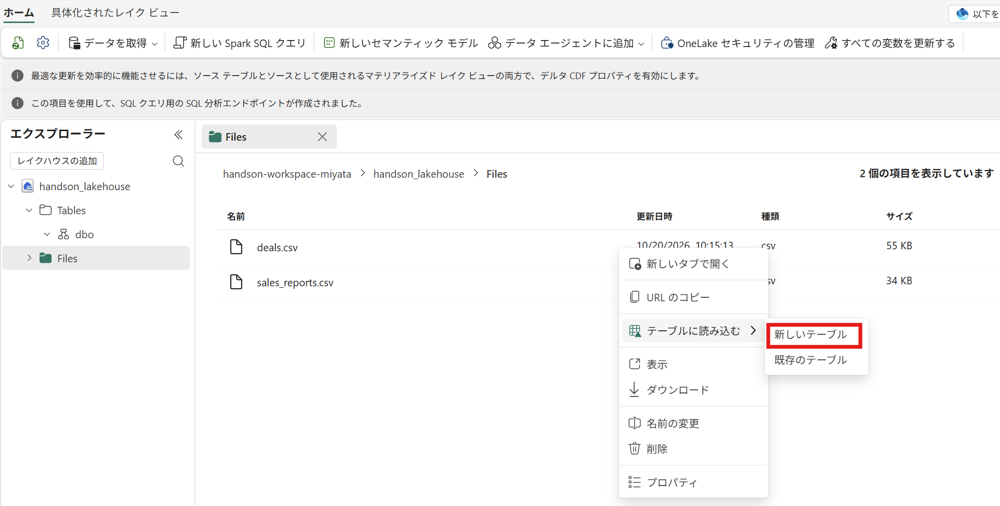

2. **新しいテーブルにファイルを読み込む** 画面で、次の設定を確認し、**読み込み** を選択します。

   | 項目 | 設定内容 |
   | --- | --- |
   | スキーマ | `dbo` |
   | 新しいテーブル名 | `deals` |
   | 列名にヘッダーを使用する | チェックを入れます |
   | 区切り記号 | カンマ（`,`） |

   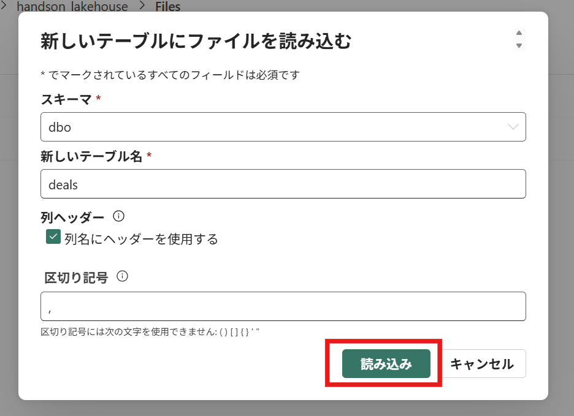

   CSV の1行目には `deal_status` や `inquiry_no` などの列名が入っています。**列名にヘッダーを使用する** を有効にすることで、この行をデータではなく列名として扱います。

3. 読み込みが完了したら、**`sales_reports.csv`** でも同じ操作を行います。スキーマは **`dbo`**、新しいテーブル名は **`sales_reports`** とし、ヘッダーあり・カンマ区切りで読み込みます。2つの CSV は列構成が異なるため、それぞれ別の新しいテーブルに読み込んでください。

   > 既に同名のテーブルがある場合は、再実行する前に読み込み先を確認してください。この手順では初回の新規作成を行います。「既存のテーブル」への読み込みは使用しません。

### 読み込み結果の確認

エクスプローラーの **Tables → dbo** を展開し、**`deals`** と **`sales_reports`** の2つのテーブルが表示されることを確認します。それぞれのテーブルを選択すると、データをプレビューできます。

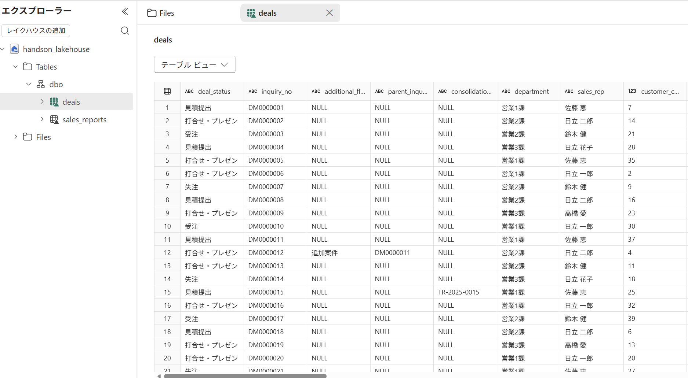

次の点を確認してください。

- `deals` に `deal_status`、`inquiry_no`、`department`、`sales_rep` などの列があること。
- `sales_reports` に `report_date`、`reporter`、`inquiry_no`、`purpose` などの列があること。
- 日本語の顧客名・担当者名などが文字化けしていないこと。
- 「0. ハンズオンで使うデータの確認」の先頭5行と、対応する案件番号・報告番号の値が一致すること。テーブルの表示順は CSV と同じとは限らないため、行番号ではなく番号の値で照合します。

> CSV の空欄は、テーブル上では `NULL` と表示されることがあります。また、読み込み時には列の型が自動推定されます。画像では `customer_code` が数値として読み込まれ、元の `00007` が `7` と表示されています。コードの先頭ゼロを保持する必要がある場合は、文字列型として取り込む設計が必要です。

これで、以降の演習で使用する **`dbo.deals`** と **`dbo.sales_reports`** が用意できました。2つのテーブルは、共通の **`inquiry_no`** で関連付けます。

## 4. データエージェントの作成と確認

レイクハウスをデータソースにするデータエージェント **`sales_agent`** を作成します。この演習の目的は、**テーブル定義やスキーマの説明、列の日本語訳を手動で追加しなくても、エージェントが既存の列名から意味をある程度推測し、日本語の質問に対応する SQL を生成できることを確認する**ことです。

この手順では、セマンティックモデルを作成せず、前の手順で用意したレイクハウスのテーブルを直接使用します。
単一テーブルの集計に続き、2つのテーブルを案件番号で関連付ける必要がある質問も試します。

> 「情報を与えない」とは、利用者が定義書や列の説明を追加しないという意味です。エージェントがスキーマを参照しないわけではありません。エージェントは、選択したデータソースの参照可能なスキーマ・メタデータを利用してクエリを生成します。参考：[データエージェントの仕組み](https://learn.microsoft.com/ja-jp/fabric/data-science/concept-data-agent#how-the-fabric-data-agent-works)。

### データエージェントの作成

1. 自分のワークスペースの **`handson_lakehouse`** を開き、画面上部の **データ エージェントに追加 → 新しいデータ エージェント** を選択します。

   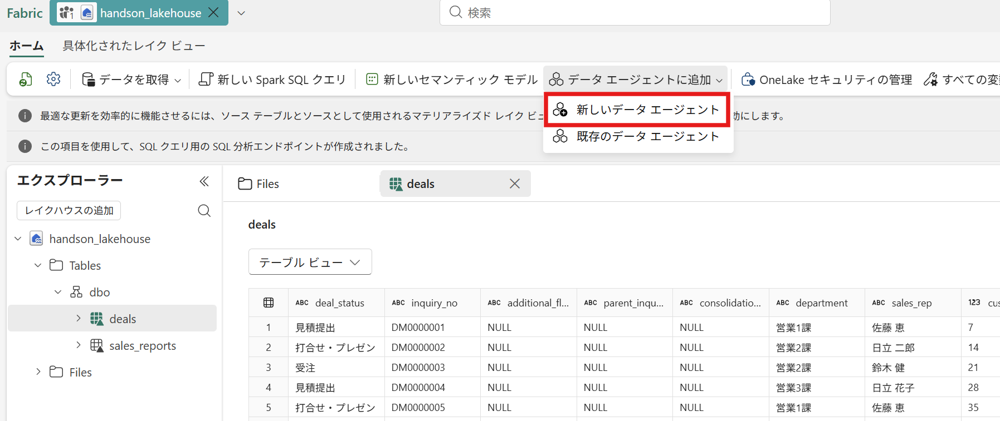

2. **新しいデータ エージェント** 画面で、画像と同じ **`sales_agent`** を入力し、**作成** を選択します。

   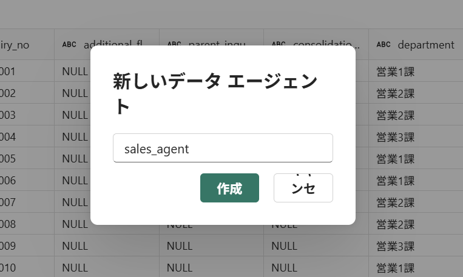

3. データエージェントの編集画面が開いたら、左側の **ソース** で **handson_lakehouse → Schemas → dbo → Tables** を展開し、**`deals`** と **`sales_reports`** の両方にチェックが入っていることを確認します。

   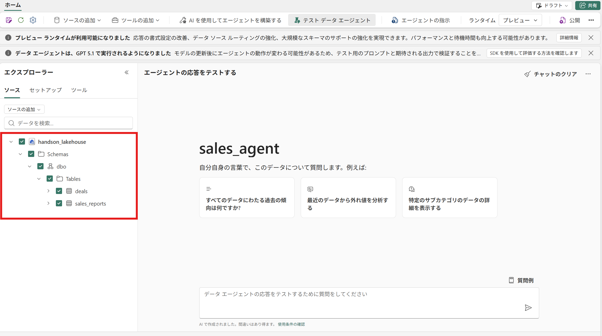

   > レイクハウスが表示されていない場合は、**ソースの追加** から自分のワークスペースの `handson_lakehouse` を追加します。同じ名前でも、他の受講生のレイクハウスを選択しないでください。

4. この段階では、**エージェントの指示** や、テーブル・列の説明、質問と SQL の例を追加せず、そのまま次のテストへ進みます。

### 日本語で質問する

画面上部の **テスト データ エージェント** を選択し、**エージェントの応答をテストする** 画面の入力欄に、次の質問だけを入力して送信します。テーブル名や列名、集計に使用する SQL は質問に含めません。

```text
営業部門別に、案件数、受注規模の合計、想定粗利金額の合計を比較してください。
```

確認のポイントは、質問に含まれる日本語と、実際の列名・集計方法を対応付けられるかどうかです。以下は回答を確認するための対応表であり、エージェントへ入力する必要はありません。

| 質問中の項目 | 対応する列・集計 |
| --- | --- |
| 営業部門別 | `department` でグループ化 |
| 案件数 | 案件一覧の行数 |
| 受注規模の合計 | `order_scale_amt` の合計 |
| 想定粗利金額の合計 | `est_gross_profit_amt` の合計 |

回答が返ると、文章による比較説明や集計表が表示されます。画像では、比較用のグラフも生成されています。

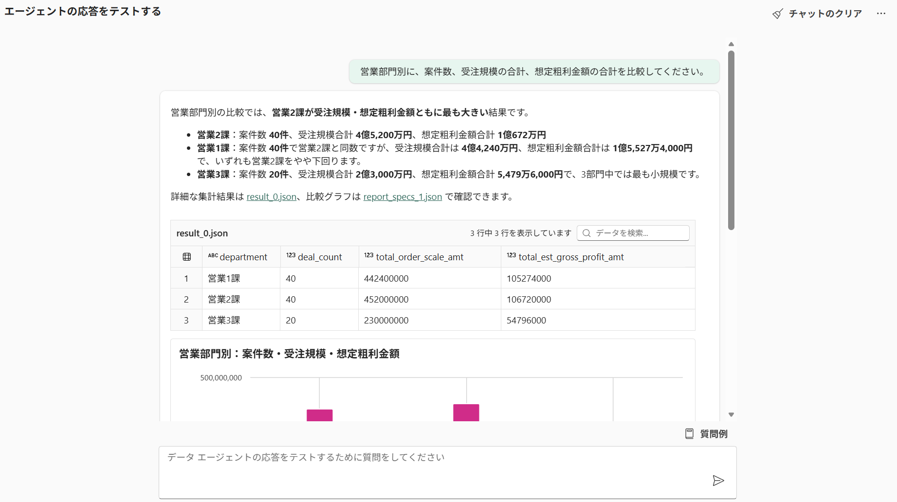

元の CSV から計算した確認用の集計値は、次のとおりです。金額は CSV の値のまま記載しています。

| 営業部門 | 案件数 | 受注規模の合計 | 想定粗利金額の合計 |
| --- | --- | --- | --- |
| 営業1課 | 40 | 442,400,000 | 105,274,000 |
| 営業2課 | 40 | 452,000,000 | 106,720,000 |
| 営業3課 | 20 | 230,000,000 | 54,796,000 |

営業1課と営業2課は案件数が同じですが、受注規模と想定粗利金額の合計は営業2課が最も大きくなります。案件数の合計が **100件** であることも確認してください。

> 回答の表現、表示順、グラフの有無は実行時に異なる場合があります。文章が自然かどうかだけではなく、参照した列と集計値が正しいかを確認します。また、受注規模は確定した受注金額とは異なります。

### 生成された SQL を確認する

回答の下にある実行手順を展開し、**生成された SQL → 実行と出力** を確認します。画像では、データエージェントが次の SQL を生成しています。

```sql
SELECT
    department,
    COUNT(*) AS deal_count,
    SUM(order_scale_amt) AS total_order_scale_amt,
    SUM(est_gross_profit_amt) AS total_est_gross_profit_amt
FROM dbo.deals
GROUP BY department
ORDER BY department;
```

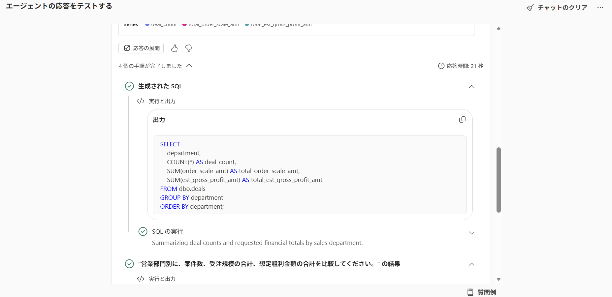

次の点を確認してください。SQL の書き方は、この例と完全に同じでなくても構いません。

- 参照先が **`dbo.deals`** であること。この質問の集計には、営業報告のテーブルは必要ありません。
- **`department`** でグループ化し、案件数と2つの金額の合計を求めていること。
- 受注規模に **`order_scale_amt`**、想定粗利金額に **`est_gross_profit_amt`** を使用していること。
- 不要な絞り込みや、営業報告との結合による案件の重複集計がないこと。

### 2つのテーブルの結合が必要な質問を試す

次に、営業報告の内容を条件にして、案件の受注金額を調べます。**ソース** で `deals` と `sales_reports` の両方が選択されていることを確認し、テスト画面で次の質問を送信してください。テーブル名・列名・結合キーは質問に含めません。

```text
「納期調整」の報告がある受注済み案件と、その受注金額を教えて。
```

この質問は、どちらか一方のテーブルだけでは答えられません。

| 質問で必要な情報 | 参照先 |
| --- | --- |
| 「納期調整」の営業報告があること | `dbo.sales_reports.purpose` |
| 案件ステータスが「受注」であること | `dbo.deals.deal_status` |
| 対象案件の受注金額 | `dbo.deals.order_amt` |

**営業報告と案件一覧を、共通の `inquiry_no`（案件番号）で関連付けられるか**が確認のポイントです。

#### 回答の確認

画像では、条件に該当する案件が **2件** と回答され、案件番号・案件名・顧客名・受注金額などが表示されています。

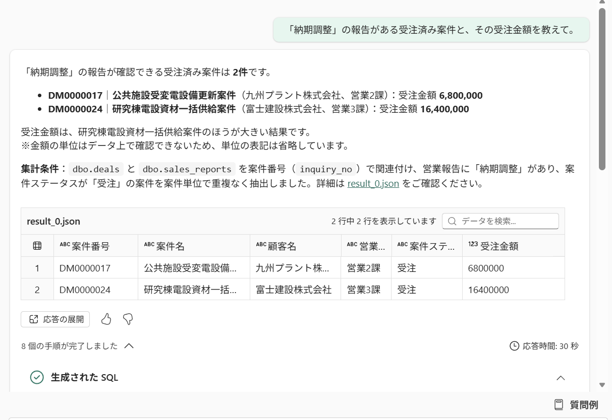

元の CSV から確認した結果は、次のとおりです。金額は CSV の値のまま記載しています。

| 案件番号 | 案件名 | 顧客名 | 案件ステータス | 受注金額 |
| --- | --- | --- | --- | --- |
| DM0000017 | 公共施設受変電設備更新案件 | 九州プラント株式会社 | 受注 | 6,800,000 |
| DM0000024 | 研究棟電設資材一括供給案件 | 富士建設株式会社 | 受注 | 16,400,000 |

#### 結合条件と生成された SQL の確認

回答の実行手順から **生成された SQL → 実行と出力** を開きます。画像では、次の SQL が生成されています。

```sql
SELECT DISTINCT
    d.inquiry_no AS 案件番号,
    d.deal_name AS 案件名,
    d.customer_name AS 顧客名,
    d.department AS 営業部門,
    d.deal_status AS 案件ステータス,
    d.order_amt AS 受注金額
FROM dbo.deals AS d
INNER JOIN dbo.sales_reports AS sr
    ON d.inquiry_no = sr.inquiry_no
WHERE d.deal_status = N'受注'
    AND sr.purpose LIKE N'%納期調整%';
```

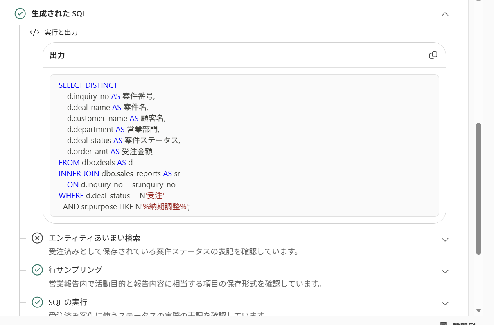

- **結合キー**：`d.inquiry_no = sr.inquiry_no` で、同じ案件の情報を関連付けています。
- **抽出条件**：案件一覧の `deal_status` で「受注」、営業報告の `purpose` で「納期調整」を含む報告を選んでいます。
- **受注金額**：受注規模の `order_scale_amt` ではなく、`order_amt` を取得しています。
- **重複の除外**：同じ案件に複数の該当報告があっても、`SELECT DISTINCT` により案件を重複なく表示しています。

SQL が完全に同じでなくても、`EXISTS` などで同じキーと条件を使い、同じ案件を重複なく取得できれば構いません。**両方のテーブルを使っているかだけでなく、正しいキー・条件・金額項目を選んでいるか**を確認してください。

> 参考手順の説明や指示を追加済みの場合は、その設定を利用した動作確認になります。説明なしでどこまで判断できるかを確認する場合は、参考設定を追加する前に試してください。

### この演習で確認すること

画像の例では、列の説明や集計方法を追加していない状態でも、「営業部門」を `department`、「受注規模」を `order_scale_amt`、「想定粗利金額」を `est_gross_profit_amt` に対応付け、集計する SQL が生成されています。**既存の列名やスキーマを手掛かりに、ある程度の意味を推測して質問に答えられる**ことを確認します。

ただし、業務用語や指標の定義まで常に正しく推測できるわけではありません。この例で正しく集計できたことと、どの質問にも正しく答えられることは区別してください。曖昧な列名や独自の業務ルールがある場合は、追加の説明や指示、セマンティックモデルなどで意味を明確にする必要があります。

回答や集計値が異なる場合は、選択したソースとテーブル、生成された SQL を確認してください。データエージェントを作成・実行できない場合は、主催者に[事前準備のテナント設定](./preparation.md#4-テナント設定)と容量・権限の確認を依頼します。

この手順では、編集画面でのテストまでを行います。**公開・共有の操作は不要**です。他の受講生へのアクセス権は追加しないでください。

### 参考：スキーマオブジェクトの説明を追加する

前の演習は、**説明を追加しない状態での動作確認**です。ここからは任意の参考手順として、テーブルや列の意味をエージェントに補足する入力方法を紹介します。業務用語や略語、似た名前の金額項目など、列名だけでは判断しにくい内容を説明する際に使用します。

1. **`sales_agent`** の編集画面で、左側のエクスプローラーの **セットアップ** タブを選択します。
2. **`handson_lakehouse`** の配下にある **スキーマ オブジェクトの説明** を選択します。
3. 右側で **Schemas → dbo → Tables → deals** を展開します。営業報告の説明を追加する場合は、同じように **sales_reports** を展開します。
4. 説明を追加したいテーブルや列の行にある **鉛筆アイコン** を選択し、入力欄に意味や使い方を記載します。画像では、**`additional_flag`** 列の説明欄を開いています。
5. 入力したら **Done** を選択して確定します。画像の列説明の入力欄は、最大 **500文字** です。

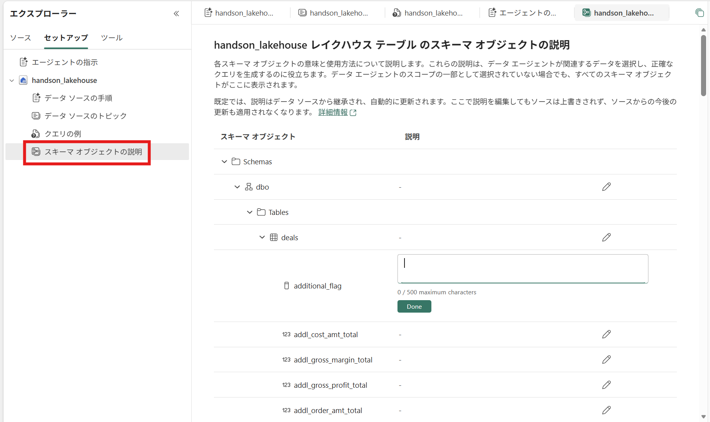

説明には、単に列名を日本語に訳すだけでなく、**何を表すか、どのように使うか、混同しやすい項目との違い**を記載します。今回のデータでは、たとえば次のように入力できます。すべての項目に入力する必要はありません。

| 対象 | 説明の入力例 |
| --- | --- |
| `dbo.deals` | 営業案件の一覧。1行が1件の案件を表す。案件番号は inquiry_no。 |
| `dbo.deals.department` | 案件を担当する営業部門名。営業1課、営業2課、営業3課など。営業部門別の集計に使用する。 |
| `dbo.deals.order_scale_amt` | 案件の受注規模額。受注前の案件にも値がある。確定した受注金額を表す order_amt とは区別する。 |
| `dbo.deals.est_gross_profit_amt` | 案件の想定粗利金額。想定粗利の合計を求める場合に使用する。実績の粗利金額 gross_profit_amt とは区別する。 |
| `dbo.sales_reports` | 案件に対する営業報告の一覧。1行が1件の報告を表す。同じ案件に複数の報告があるため、案件数と報告件数は区別する。 |
| `dbo.sales_reports.inquiry_no` | 報告の対象となる案件番号。deals の inquiry_no と関連付けるために使用する。 |

> この画面の説明は、既定ではデータソースから継承され、自動更新されます。ここで編集しても元のデータソースの説明は上書きされませんが、編集した説明には、データソース側からの今後の更新が適用されなくなります。また、スコープに選択していないオブジェクトも表示されるため、説明を入力することと、質問に使用するテーブルを **ソース** で選択することは別の操作です。

説明を追加した場合は、**テスト データ エージェント** に戻り、**チャットのクリア** で会話履歴をクリアしてから、同じ質問を再度送信します。説明を追加する前後で、使用する列や生成された SQL、回答がどう変わるかを比較してください。

### 参考：エージェントの指示を追加する

**エージェントの指示** は、エージェント全体の役割、データの使い分け、共通の用語、回答形式などを伝える設定です。個々のテーブルや列の意味を説明する **スキーマ オブジェクトの説明** とは、設定の対象が異なります。

ここも任意の参考手順です。まずは指示を追加しない状態で前の演習を終えてから、必要に応じて設定してください。

1. **`sales_agent`** の編集画面で、左側の **セットアップ** タブを選択します。
2. **エージェントの指示** を選択します。画面上部の **エージェントの指示** から開くこともできます。
3. 右側の入力欄が **形式：Markdown** になっていることを確認し、以下の記載例の本文を入力します。コードブロックを囲む行は貼り付け不要です。画像の入力欄は最大 **15,000文字** です。

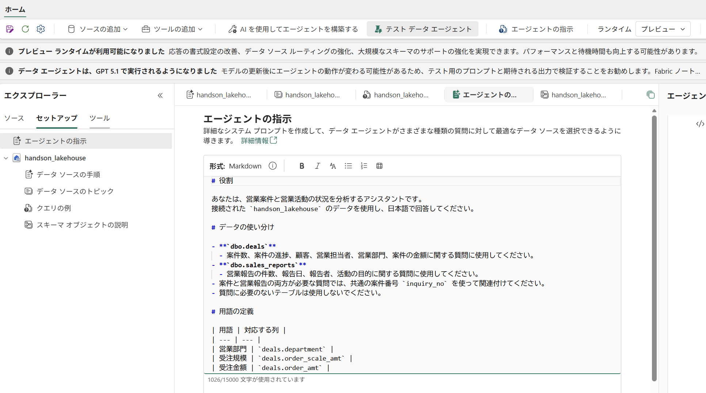

#### 今回のシナリオ向けの記載例

```markdown
# 役割

あなたは、営業案件と営業活動の状況を分析するアシスタントです。
接続された `handson_lakehouse` のデータを使用し、日本語で回答してください。

# データの使い分け

- **`dbo.deals`**
  - 案件数、案件の進捗、顧客、営業担当者、営業部門、案件の金額に関する質問に使用してください。
- **`dbo.sales_reports`**
  - 営業報告の件数、報告日、報告者、活動の目的に関する質問に使用してください。
- 案件と営業報告の両方が必要な質問では、共通の案件番号 `inquiry_no` を使って関連付けてください。
- 質問に必要のないテーブルは使用しないでください。

# 用語の定義

| 用語 | 対応する列 |
| --- | --- |
| 営業部門 | `deals.department` |
| 受注規模 | `deals.order_scale_amt` |
| 受注金額 | `deals.order_amt` |
| 想定粗利金額 | `deals.est_gross_profit_amt` |
| 実績の粗利金額 | `deals.gross_profit_amt` |

# 集計上の注意

- **案件数と営業報告の件数を区別してください。**
  - 同じ案件に複数の営業報告が存在します。
  - 案件数は案件一覧、営業報告の件数は営業報告から集計してください。
- 営業報告と関連付ける際に、案件数や案件の金額を重複して集計しないでください。
- **受注規模と受注金額を区別してください。**
  - 受注規模は受注前の案件にも値があるため、確定した受注金額として扱わないでください。
- **想定粗利金額と実績の粗利金額を区別してください。**
- 対象期間、案件ステータス、指標の意味が曖昧で、解釈によって結果が大きく変わる場合は、利用者に確認してください。

# 回答の形式

- 最初に結論を簡潔に示してください。
- 続けて集計表と主な比較ポイントを示してください。
- 使用したテーブル、集計項目、絞り込み条件を説明してください。
- データから確認できる事実と、推測や考察を区別してください。
- データにない情報や、確認できない数値は作らないでください。
- 金額の単位が確認できない場合は、円などの単位を断定しないでください。
```

#### 入力後の確認

入力内容が保存されたことを確認し、**テスト データ エージェント** に戻ります。**チャットのクリア** で会話履歴をクリアしてから、前の演習と同じ質問を送信してください。

- 案件の集計に `dbo.deals` を使用しているか。
- 受注規模と受注金額、想定粗利と実績粗利を区別しているか。
- 結論、集計表、使用したテーブルや条件が回答に含まれるか。
- 指示を追加する前後で、回答や生成された SQL にどのような違いがあるか。

指示を追加しても、回答の正確性が保証されるわけではありません。引き続き、生成された SQL と元データに基づく集計値を確認してください。スキーマの説明とエージェントの指示の効果を個別に比較する場合は、一度に両方を変更せず、変更した設定を記録して比較します。

## 5. セマンティックモデルの作成

レイクハウスの2つのテーブルを使用して、セマンティックモデル **`sales_semantic_model`** を作成します。前の演習ではエージェントに列や結合キーを判断させましたが、ここでは、テーブル・列の説明やテーブル間の関係をモデル側に明示的に定義します。

### モデルの作成とテーブルの選択

1. 自分のワークスペースの **`handson_lakehouse`** を開き、画面上部の **新しいセマンティック モデル** を選択します。

   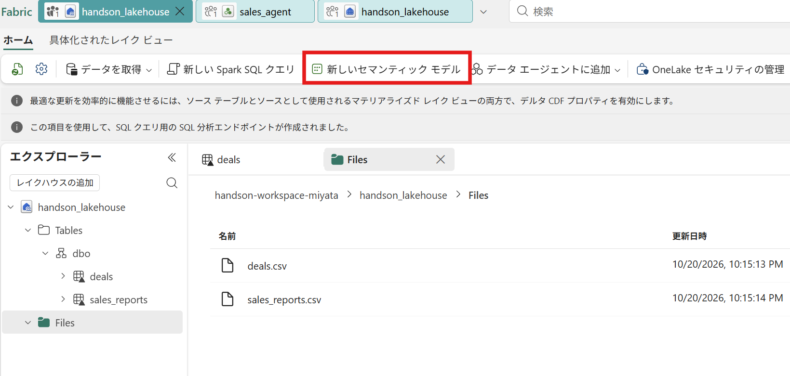

2. **新しいセマンティック モデル** 画面で、次の内容を設定します。

   | 項目 | 設定内容 |
   | --- | --- |
   | Direct Lake セマンティック モデル名 | 画像と同じ `sales_semantic_model` |
   | ワークスペース | 自分で作成したワークスペース |
   | 使用するテーブル | `dbo` 配下の `deals` と `sales_reports` の両方にチェックを入れます |

   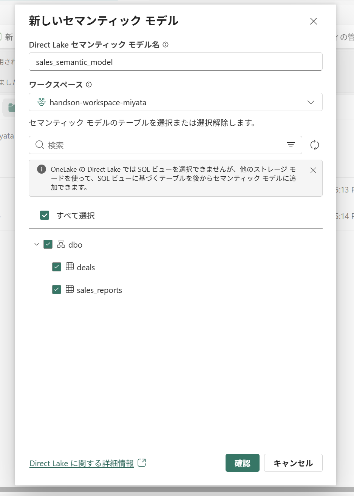

   > 画像のワークスペース名 `handson-workspace-miyata` は表示例です。自分のワークスペースを選択してください。この手順では、読み込み済みのテーブルを使用する **Direct Lake** モデルを作成します。CSV を再アップロードする必要はありません。

3. **確認** を選択し、モデルの編集画面が開くまで待ちます。モデル図に **`deals`** と **`sales_reports`** が表示されることを確認します。閲覧モードの場合は、画面右上の **編集** から編集モードに切り替えてください。

### テーブル・列の説明を設定する

モデル図や右側の **データ** ペインでテーブル・列を選択すると、**プロパティ** ペインに名前、説明、データ型などが表示されます。画像では、`deals` の **`additional_flag`** 列を選択しています。

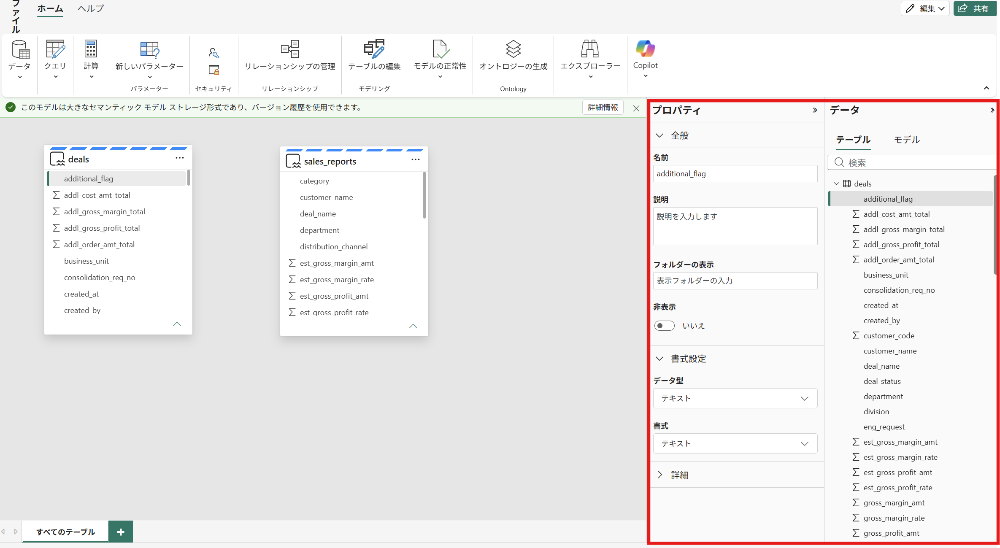

必要に応じて **説明** 欄に、そのテーブルや列の意味を入力します。すべての列を設定する必要はありません。たとえば、次の項目から補足できます。

| 対象 | 説明の入力例 |
| --- | --- |
| `deals` | 営業案件の一覧。1行が1件の案件を表す。inquiry_no は案件を一意に識別する番号。 |
| `sales_reports` | 営業報告の一覧。同じ inquiry_no に対して複数の報告を記録できる。 |
| `deals.order_scale_amt` | 案件の受注規模額。受注前の案件にも値があるため、確定した受注金額 order_amt とは区別する。 |
| `deals.est_gross_profit_amt` | 案件の想定粗利金額。実績の粗利金額 gross_profit_amt とは区別する。 |

ここで入力するのは、**セマンティックモデル側の説明**です。前の参考手順で入力した、データエージェント側のスキーマオブジェクトの説明とは設定場所が異なります。

### 案件番号でリレーションシップを作成する

1. モデル図の各テーブルをスクロールし、両方の **`inquiry_no`** 列を表示します。**`deals` の `inquiry_no` を、`sales_reports` の `inquiry_no` へドラッグ**します。

   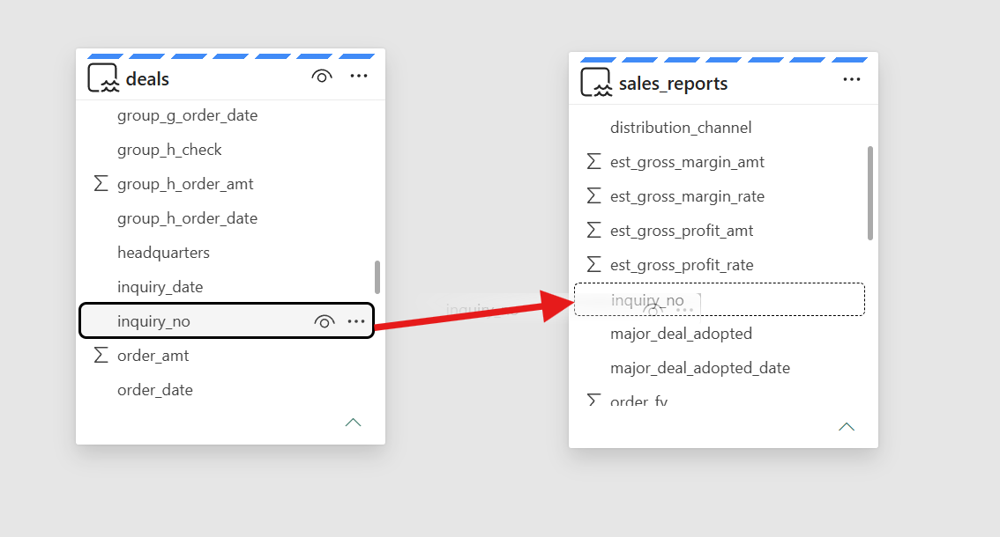

2. **新しいリレーションシップ** 画面で、次の設定を確認します。自動で選択された内容が異なる場合は修正してください。

   | 項目 | 設定内容 |
   | --- | --- |
   | From table / 列 | `deals` / `inquiry_no` |
   | To table / 列 | `sales_reports` / `inquiry_no` |
   | Cardinality（カーディナリティ） | **One to many（1:*）** |
   | Cross-filter direction（クロスフィルターの方向） | **Single（単一）** |
   | Make this relationship active | チェックを入れます |
   | Assume referential integrity | 画像と同じく、チェックを入れません |

   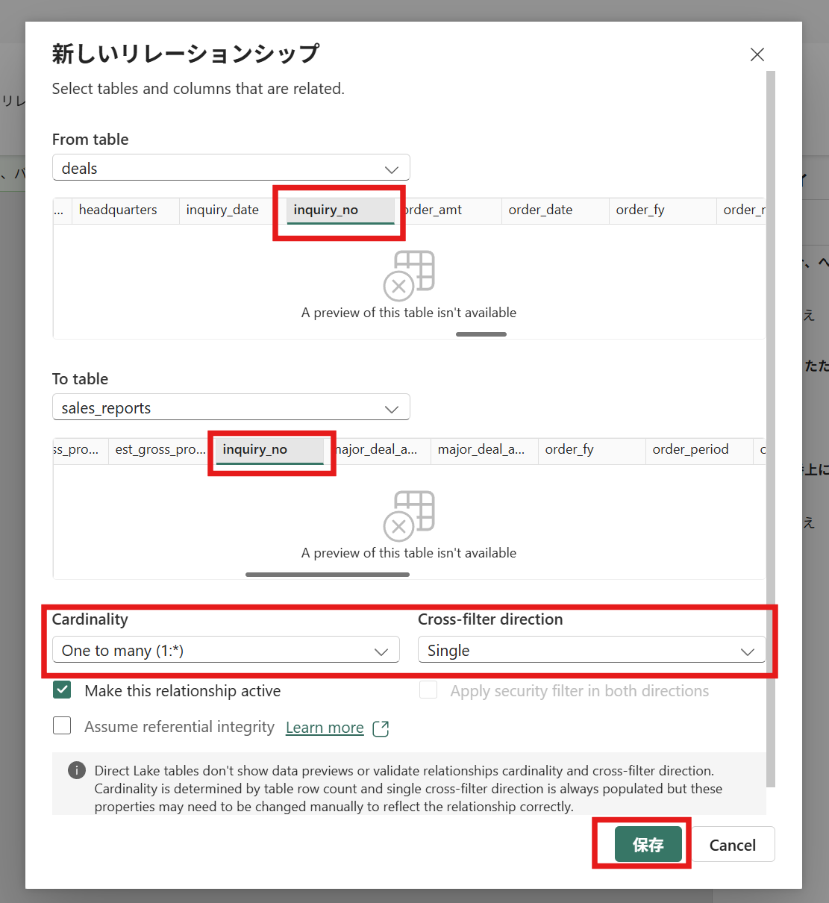

3. **保存** を選択します。モデル図で2つのテーブルが線で結ばれ、**`deals` 側が `1`、`sales_reports` 側が `*`** になっていることを確認してください。既に同じ関係がある場合は、重複して作成せず、既存の線を選択して設定を確認します。

   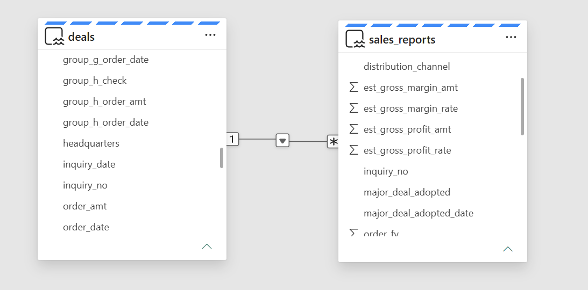

   画像はリレーションシップの作成後の状態です。**実線はアクティブな関係**、線の中央の矢印は **単一方向のフィルター伝播** を表します。線を選択して、結合する列が両方とも `inquiry_no` になっていることも確認してください。

> Direct Lake では、この設定画面にテーブルのデータプレビューが表示されない場合があります。画像にも、カーディナリティやクロスフィルター方向は検証されない旨の注意が表示されています。プレビューの有無や自動設定だけで判断せず、実データのキーの性質に合わせて設定してください。保存時にエラーが出た場合は、両方の列のデータ型が同じであることと、`deals.inquiry_no` に重複や空欄がないことを確認します。

### 設定の意味と確認ポイント

今回の CSV では、案件一覧は **100行・案件番号100種類**、営業報告は **100行・案件番号70種類** です。案件一覧の案件番号は一意ですが、営業報告には同じ案件番号の繰り返しがあるため、**案件1件に対して営業報告が複数件になる「1対多」** として定義します。

- **1側：`deals.inquiry_no`** — 案件を一意に識別します。
- **多側：`sales_reports.inquiry_no`** — 同じ案件に複数の営業報告があります。
- **単一方向** — `deals` 側で選択・絞り込みを行うと、関連する `sales_reports` にフィルターが伝わります。
- **アクティブ** — 通常の集計で使用する関係として有効にします。

> **単一方向の関係は、営業報告から案件一覧へは自動でフィルターを伝えません。** 前の演習のように「納期調整の報告がある案件の受注金額」を求める場合は、関係を作っただけで十分とは限らず、DAX などで報告側の条件を案件側へ適用する必要があります。この演習では画像どおり単一方向を使用し、双方向には変更しません。

最後に、モデル名が **`sales_semantic_model`** で、2つのテーブルと案件番号によるリレーションシップが保存されていることを確認します。これで、列の意味やテーブル間の関係を持つセマンティックモデルが用意できました。

## 6. セマンティックモデルを使ったデータエージェントの確認

セマンティックモデル **`sales_semantic_model`** をデータソースにするデータエージェント **`sales_agent_semantic`** を作成します。レイクハウスを直接参照する `sales_agent` とは別のエージェントで同じ質問を試し、回答と生成されたクエリを比較します。

### データエージェントの作成

1. 自分のワークスペースに戻り、**新しい項目** を選択します。検索欄に `データ` と入力し、**データ エージェント** を選択します。

   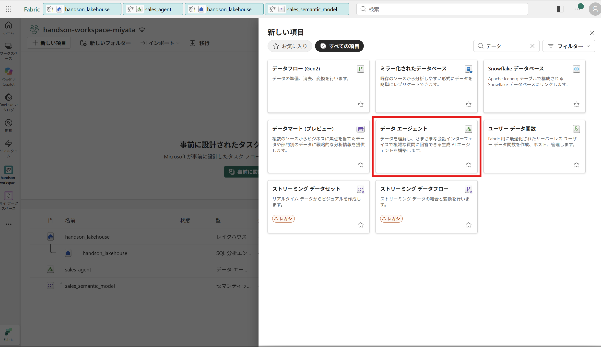

2. **データ エージェントの作成** 画面で、画像と同じ **`sales_agent_semantic`** を入力し、**作成** を選択します。

   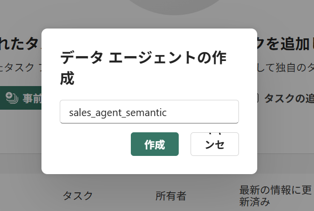

### セマンティックモデルをソースに追加する

1. エージェントの編集画面で **ソースの追加 → データ ソース** を選択します。

   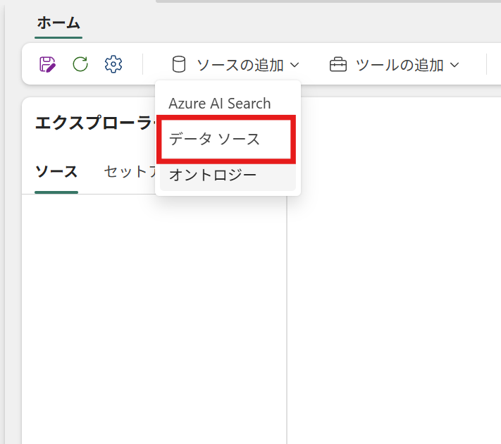

2. **データ ソースの追加** 画面で、自分のワークスペースに作成した **`sales_semantic_model`** を選択し、画面の案内に従って追加します。種類が **セマンティックモデル** であることを確認してください。

   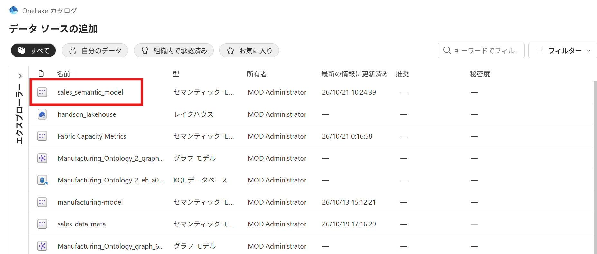

   > ここでは `handson_lakehouse` ではなく、**`sales_semantic_model`** を選択します。同名のアイテムが複数ある場合は、自分のワークスペースのモデルであることも確認してください。

3. 左側の **ソース** で `sales_semantic_model` を展開し、**`deals`** と **`sales_reports`** の両方にチェックが入っていることを確認します。比較のため、このエージェントにはレイクハウスを直接追加せず、セマンティックモデルだけをデータソースにします。

### 同じ質問で動作を確認する

**テスト データ エージェント** を開き、レイクハウスを参照した演習と同じ質問を送信します。

```text
「納期調整」の報告がある受注済み案件と、その受注金額を教えて。
```

画像では、セマンティックモデル配下の2つのテーブルが選択され、条件に合う案件が **2件** と回答されています。

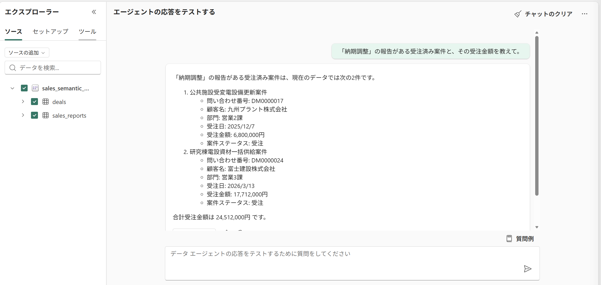

案件番号が **`DM0000017`** と **`DM0000024`** で、前の演習と同じ案件を抽出できていることを確認します。ただし、**金額にどの列を使用したか**も必ず確認してください。

### 生成された DAX を確認する

回答の下にある実行手順を展開し、**sales_semantic_model を分析した手順 → 実行と出力** を開きます。クエリの入力が非表示の場合は、表示を切り替えてください。レイクハウスを直接参照したときの SQL と異なり、画像では **DAX** が生成されています。

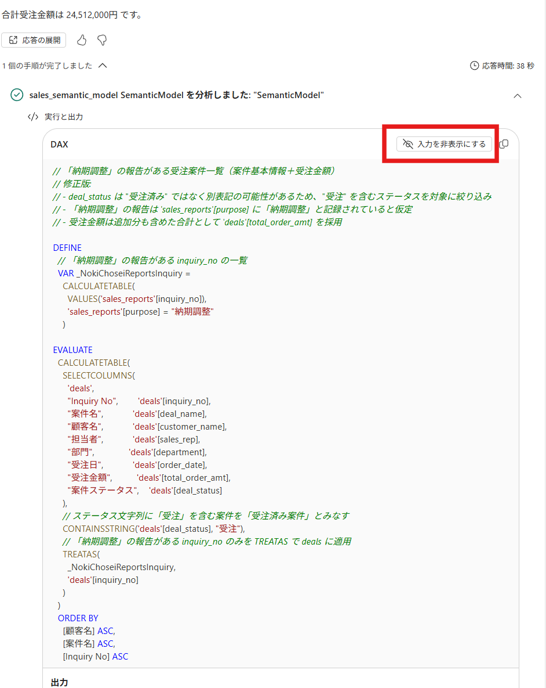

画像の DAX は、次の流れで対象案件を取得しています。

| 処理 | DAX で確認する内容 |
| --- | --- |
| 納期調整の報告がある案件番号を取得 | `sales_reports[purpose]` が「納期調整」の行を対象に、`VALUES` で `sales_reports[inquiry_no]` の重複しない値を取得 |
| 案件側に条件を適用 | `TREATAS` で、取得した案件番号を `deals[inquiry_no]` のフィルターとして適用 |
| 受注済み案件に絞り込み | 画像では `CONTAINSSTRING` で `deals[deal_status]` に「受注」を含む案件を選択 |
| 案件情報と金額を返す | `SELECTCOLUMNS` で案件番号・案件名・顧客名・金額などを取得 |

**SQL の `JOIN` がなくても、案件番号を介して両方のテーブルの情報を使っている**ことを確認します。前の手順で設定した単一方向の関係だけでは、報告側の条件は案件側へ自動で伝わりません。画像の DAX は、`TREATAS` を使って報告側から取得した案件番号を明示的に案件側へ適用しています。

### 金額の定義を確認する

画像の回答は、受注金額として **`deals[total_order_amt]`** を使用しています。一方、前のレイクハウスの演習では **`order_amt`** を使用しました。今回の2件について、元の CSV の値を比較すると次のようになります。

| 案件番号 | 受注金額（`order_amt`） | 追加受注額（`addl_order_amt_total`） | 追加受注込みの合計（`total_order_amt`） |
| --- | --- | --- | --- |
| DM0000017 | 6,800,000 | 空欄 | 6,800,000 |
| DM0000024 | 16,400,000 | 1,312,000 | 17,712,000 |

画像の合計 **24,512,000** は追加受注込みの値です。前の演習と同じ `order_amt` を使った合計は **23,200,000** です。**同じ案件が返っても、同じ金額の定義で答えているとは限りません。** このハンズオンの「受注金額」は `order_amt` として確認します。

必要に応じて、モデルの列説明やエージェントの指示で用語を補足するか、次のように質問を具体化して再テストします。

```text
「納期調整」の報告がある受注済み案件について、追加受注を含めない受注金額（order_amt）を教えて。
```

> 金額は CSV の値のまま確認します。画像の回答には「円」とありますが、単位をデータや業務上の定義から確認できない場合は、回答の単位も検証が必要です。

### 比較の確認ポイント

- **データソース**：`sales_agent` はレイクハウス、`sales_agent_semantic` はセマンティックモデルを参照しているか。
- **クエリ**：SQL と DAX の違いを確認し、案件番号を使って報告の条件を案件に適用しているか。
- **結果**：案件が重複せず2件で、同じ金額列を使えば前の演習と値が一致するか。
- **業務上の意味**：ステータスの判定方法や、受注金額・追加受注込み合計の使い分けが意図に合っているか。

モデルに関係を設定しても、列の意味や業務ルールを常に正しく判断できるわけではありません。比較時は、各エージェントの指示や列説明の追加有無も記録し、生成されたクエリと元データを確認してください。この手順も編集画面でのテストまでとし、公開・共有や他の受講生へのアクセス権追加は不要です。

## 7. オントロジーの作成

営業案件と営業報告を業務上の概念として定義するオントロジー **`sales_ontology`** を作成します。今回はセマンティックモデルからの自動生成ではなく、レイクハウスのデータを使って2つのエンティティ型と関係を手動で設定します。

**この節ではマッピングテーブルは使用せず、両方の `inquiry_no`（案件番号）を直接照合する構成**にします。後の Graph の作成では、画像に合わせてマッピングテーブルを使用する設定へ切り替えます。

### 今回作成するエンティティと関係

| エンティティ型 | 意味 | バインドするテーブル | エンティティ型キー |
| --- | --- | --- | --- |
| `SalesDeal` | 営業案件。1件の案件を表す | `handson_lakehouse` の `dbo.deals` | `inquiry_no` |
| `SalesReport` | 営業報告。1件の報告を表す | `handson_lakehouse` の `dbo.sales_reports` | `record_no` |

リレーションシップ名は **`ReportsOn`（報告対象）** とし、方向を **`SalesReport` → `SalesDeal`** にします。「この営業報告は、どの営業案件についての報告か」を表す関係です。

### オントロジーアイテムの作成

1. 自分のワークスペースの **新しい項目** を開き、**Ontology (preview)** を選択します。

   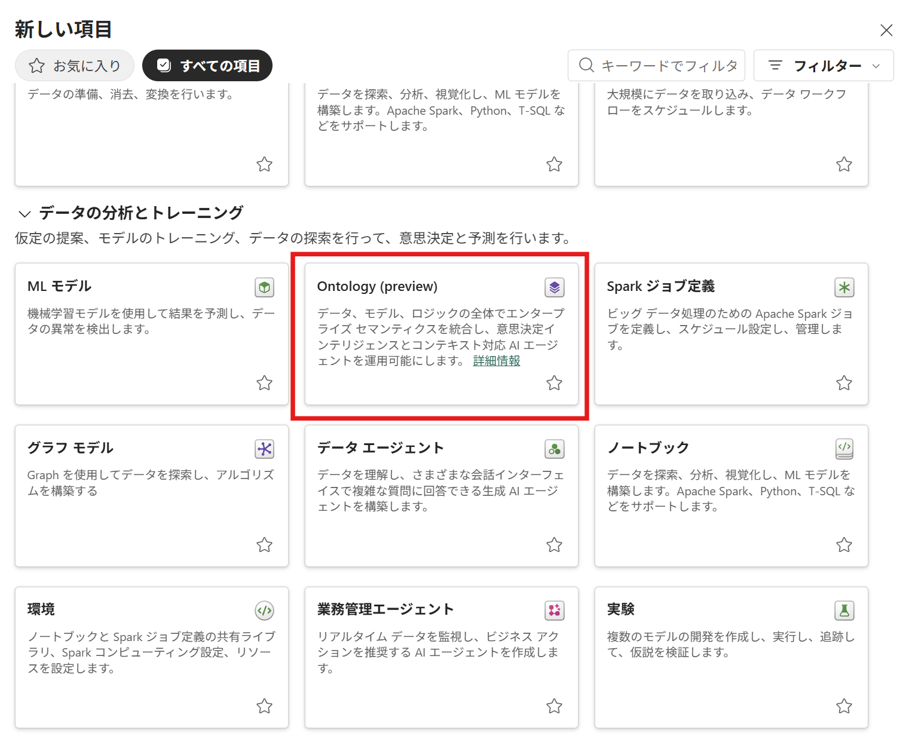

2. **新しい Ontology** 画面で、名前に画像と同じ **`sales_ontology`** を入力します。**場所** が自分のワークスペースになっていることを確認し、**作成** を選択します。

   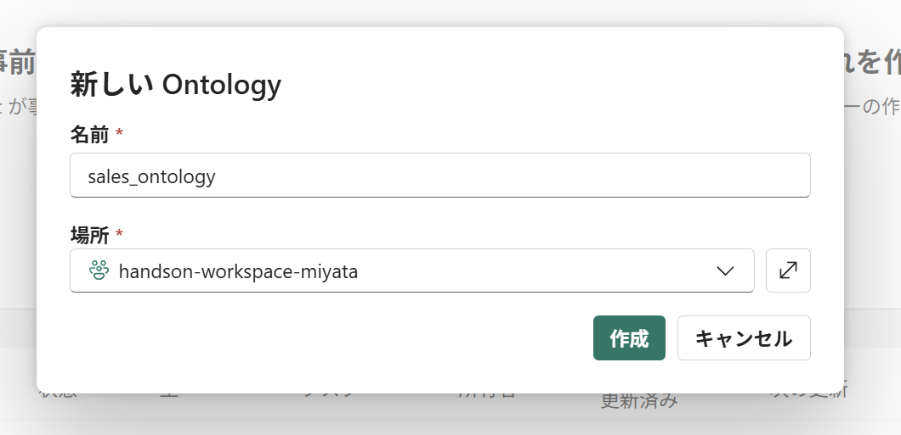

   > 画像のワークスペース名 `handson-workspace-miyata` は表示例です。実際には自分のワークスペースを選択してください。オントロジーはプレビュー機能のため、画面表示が異なる場合があります。

### 営業案件のエンティティ型を作成する

1. オントロジーのホーム画面で、画面上部の **エンティティ型の追加** を選択します。

   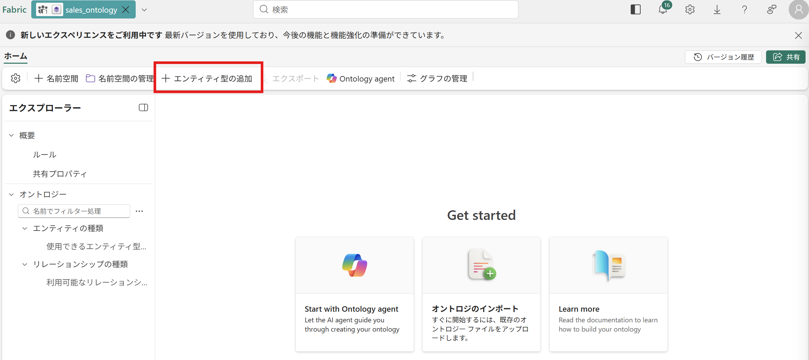

2. **エンティティ型名** に **`SalesDeal`** を入力し、**エンティティ型の追加** を選択します。追加の構成は変更せず、既定の名前空間を使用します。

   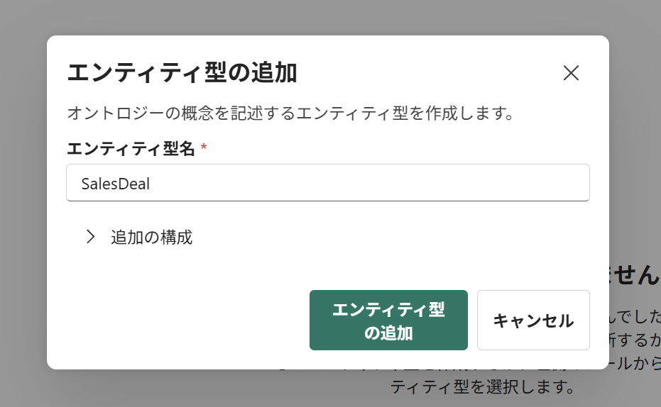

3. 作成した **SalesDeal** を選択し、画面上部の **エンティティ型の詳細を表示** を選択します。

   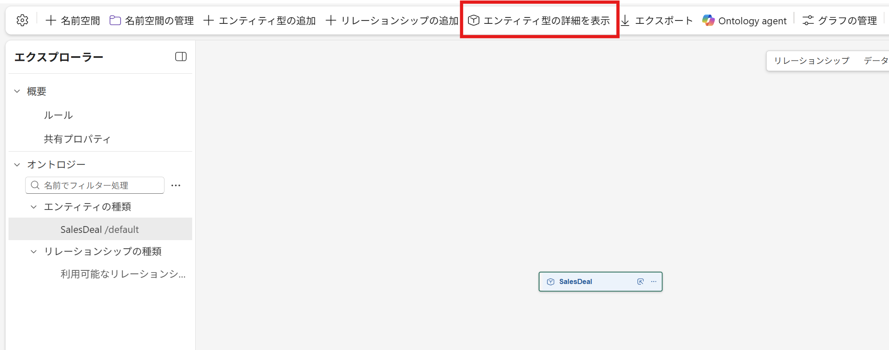

4. **構成** タブのプロパティ欄で **データからプロパティを追加** を選択します。この操作で、テーブルの列をエンティティのプロパティに対応付けます。

   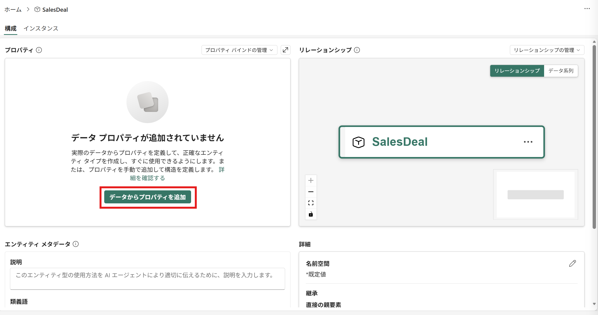

### 案件テーブルをバインドする

> **注意：後の Graph 作成に備え、データソースにはレイクハウスのテーブルを使用してください。** 現在、セマンティックモデルにデータをバインドしたエンティティ型は、Graph への投影に対応していません。本演習では `sales_semantic_model` ではなく、`handson_lakehouse` の Delta テーブル（`dbo.deals`・`dbo.sales_reports`）をそれぞれのエンティティにバインドします。
>
> 参考：[Microsoft Learn：オントロジーから Graph を実体化する — 制限事項](https://learn.microsoft.com/ja-jp/fabric/iq/ontology/how-to-use-ontology-graph#limitations) の「サポートされていないデータソース」を参照してください。

1. **プロパティ バインド** 画面の **追加** を選択します。

   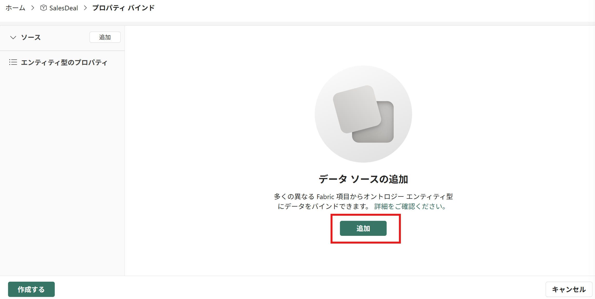

2. OneLake カタログで、自分の **handson_lakehouse → dbo → deals** を選択し、**テーブルの選択** を選択します。ここでは `sales_semantic_model` ではなく、レイクハウスのテーブルを指定します。

   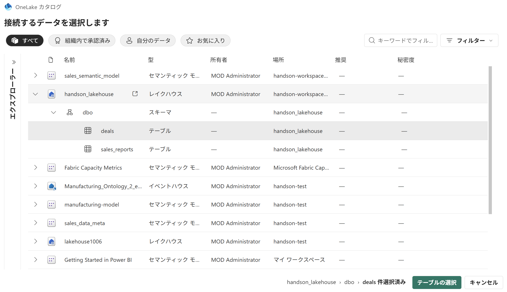

3. **エンティティ型のプロパティ** で、プロパティ名・ソース列・プロパティの種類を確認します。画像のように、元の列名をそのままプロパティ名として使用します。

   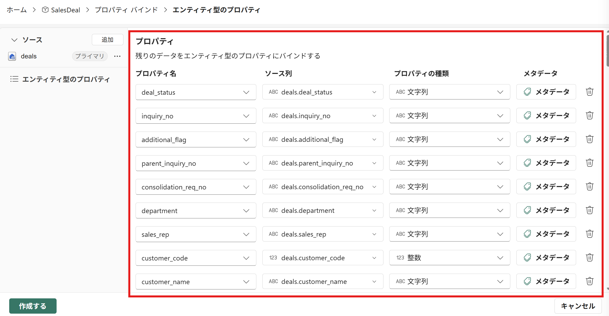

   特に、次の対応を確認してください。その他の列も、必要に応じてそのままバインドできます。

   | プロパティ名 | ソース列 | 用途 |
   | --- | --- | --- |
   | `inquiry_no` | `deals.inquiry_no` | 案件を一意に識別し、報告と関連付ける |
   | `deal_status` | `deals.deal_status` | 「受注」などの案件ステータス |
   | `order_amt` | `deals.order_amt` | 受注金額 |
   | `total_order_amt` | `deals.total_order_amt` | 追加受注込みの合計金額 |

4. **作成する** を選択して、プロパティのバインドを確定します。

   > プロパティを追加しただけでは、案件の識別キーはまだ設定されていません。続けてエンティティ型キーを定義してください。

### 営業案件のキーを定義する

1. **SalesDeal** の構成画面に戻り、**エンティティ型キーの定義** を選択します。

   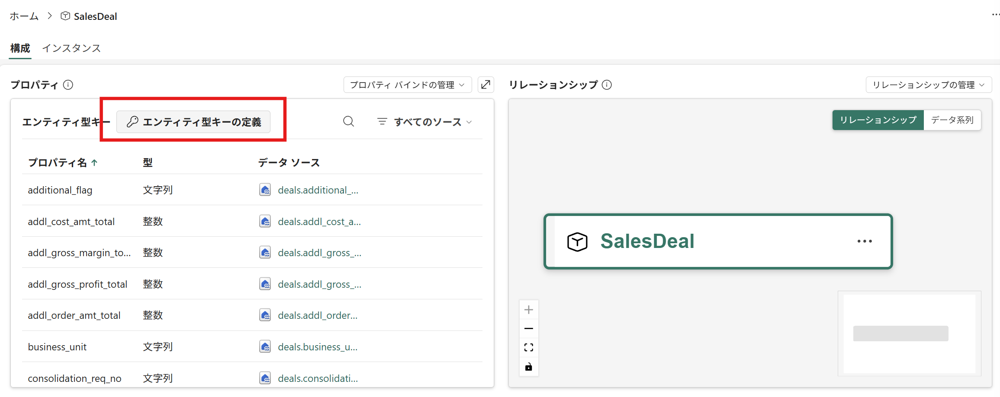

2. **キーの追加または編集** で **`inquiry_no`** を選択し、**保存** を選択します。

   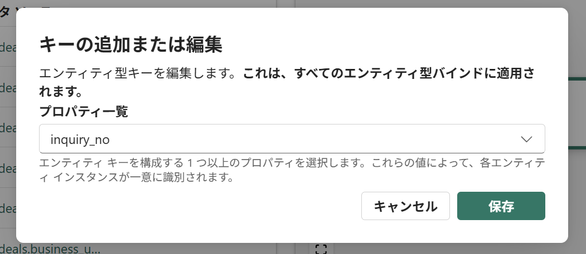

今回の案件一覧には、100件すべてで異なる案件番号が入っています。この番号をキーにすることで、1件の案件を一意に識別できます。

### 営業報告のエンティティ型を作成する

1. ホーム画面に戻り、**エンティティ型の追加** から **`SalesReport`** を作成します。

   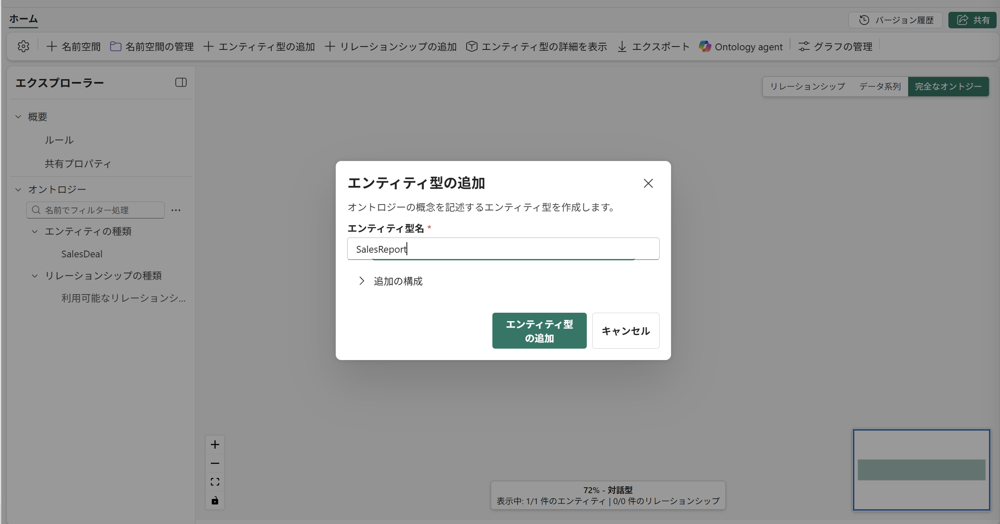

2. **SalesDeal** と同じ手順で **エンティティ型の詳細を表示 → データからプロパティを追加 → 追加** と進みます。今度は **handson_lakehouse → dbo → sales_reports** を選択し、プロパティをバインドします。
3. プロパティに **`record_no`**、**`inquiry_no`**、**`purpose`**、**`report_date`**、**`reporter`** などが含まれることを確認し、**作成する** を選択します。
4. **エンティティ型キーの定義** で **`record_no`** を選択し、保存します。

> **SalesReport のキーは `inquiry_no` ではなく、`record_no` です。** 同じ案件に複数の報告があるため、案件番号では個々の報告を区別できません。`record_no` は報告そのものを識別し、`inquiry_no` は報告対象の案件へつなぐために使用します。

必要に応じて、各エンティティの **エンティティ メタデータ → 説明** に「営業案件の一覧」「案件に対する営業活動の報告」など、業務上の意味を補足できます。

### 報告対象のリレーションシップを作成する

1. ホーム画面で **SalesDeal** と **SalesReport** の両方があることを確認し、画面上部の **リレーションシップの追加** を選択します。

   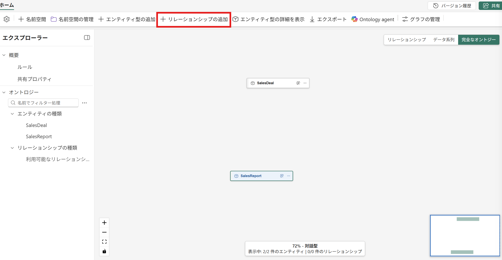

2. **新しいリレーションシップの追加** 画面で、次の内容を指定し、**作成** を選択します。

   | 項目 | 設定内容 |
   | --- | --- |
   | リレーションシップの種類の名前 | `ReportsOn` |
   | 元のエンティティ型 | `SalesReport` |
   | ターゲット エンティティ型 | `SalesDeal` |

   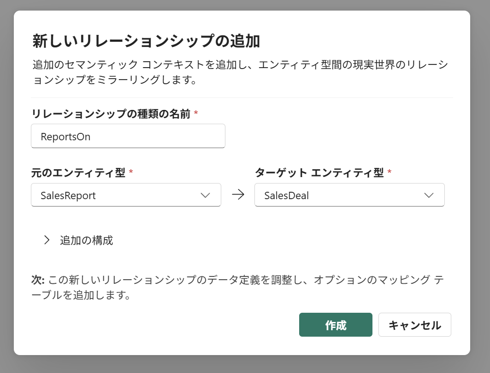

3. 作成した **ReportsOn** を選択し、**リレーションシップの種類の詳細を表示する** を開きます。この段階では関係の名前と方向を作成した状態なので、続けて照合するプロパティを設定します。

   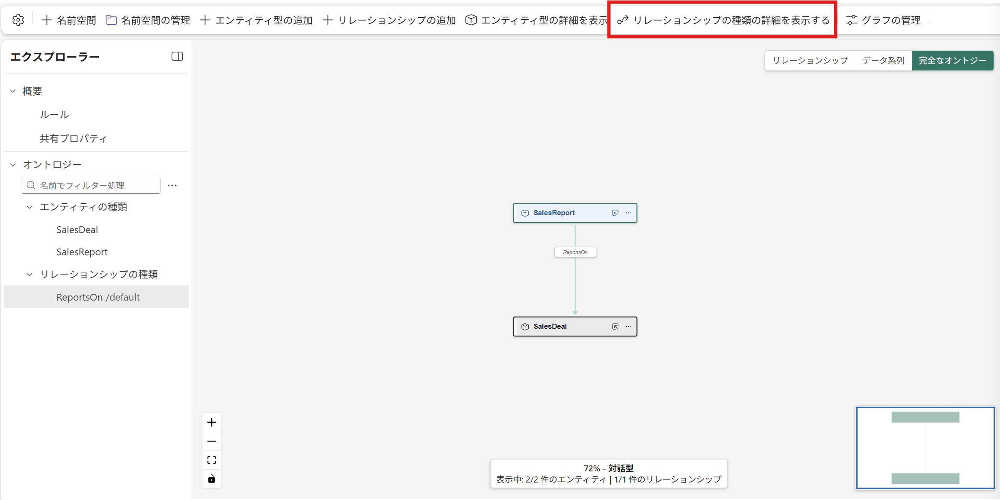

4. **マッピング テーブルを使用しますか？** を **オフ** にし、次のように指定します。

   | 項目 | 設定内容 |
   | --- | --- |
   | マッピングテーブルを使用 | **オフ** |
   | 元のエンティティ型 / プロパティ | `SalesReport` / `inquiry_no` |
   | リレーションシップ名 | `ReportsOn` |
   | ターゲット エンティティ型 / プロパティ | `SalesDeal` / `inquiry_no` |

   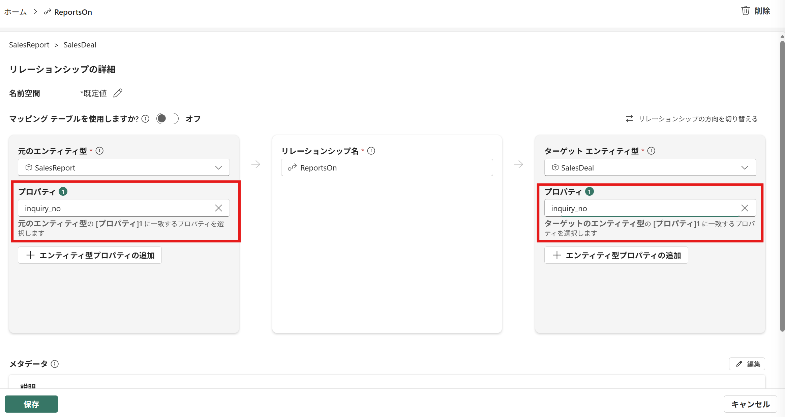

5. **保存** を選択します。元とターゲットの両方で `inquiry_no` が選択され、**SalesReport → ReportsOn → SalesDeal** の向きになっていることを確認してください。

   > ここでは `sales_reports` や `deals` をマッピングテーブルとして選択しません。**エンティティの識別キーと、関係をつなぐプロパティは別の設定**です。SalesReport の識別キーは `record_no` のまま、関係の照合には両方の `inquiry_no` を使用します。

### 作成後の確認ポイント

- オントロジー名が **`sales_ontology`** で、自分のワークスペースに作成されていること。
- **SalesDeal** が `dbo.deals`、**SalesReport** が `dbo.sales_reports` にバインドされていること。
- 識別キーが **SalesDeal：`inquiry_no` / SalesReport：`record_no`** であること。
- **ReportsOn** が営業報告から営業案件への関係を表し、両方の `inquiry_no` を照合していること。
- **マッピングテーブルはオフ** になっていること。

たとえば、報告番号 `4801` の営業報告は案件番号 `DM0000005` を持つため、その番号の営業案件を報告対象として関連付けます。これで、単なる列同士の対応に加えて、**「営業報告は営業案件について報告する」という業務上の意味を持つ関係**を定義できました。

> この節は、エンティティ型・プロパティのバインド・リレーションシップの設定までを対象とします。**Graph の作成・実体化は「9. Graph の作成と確認」で行います。** 設計キャンバスにエンティティ間の線が表示されることと、実データを持つ Graph に投影されることは別です。

## 8. オントロジーを使ったデータエージェントの確認

前の手順で作成した **`sales_ontology`** を追加するデータエージェント **`sales_agent_ontology`** を作成します。レイクハウス・セマンティックモデルの演習と同じ質問を送り、オントロジーを追加した場合の回答と生成クエリを確認します。

### データエージェントの作成

1. 自分のワークスペースの **新しい項目** を開き、**データ エージェント** を選択します。
2. **データ エージェントの作成** 画面で、画像と同じ **`sales_agent_ontology`** を入力し、**作成** を選択します。既存の `sales_agent` や `sales_agent_semantic` とは別のエージェントとして作成してください。

   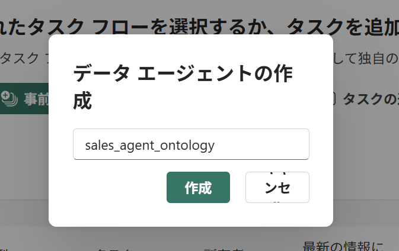

### オントロジーをソースに追加する

1. エージェントの編集画面で **ソースの追加 → オントロジー** を選択します。今回は **データ ソース** ではなく、**オントロジー** を選びます。

   

2. 自分のワークスペースに作成した **`sales_ontology`** を選択し、画面の案内に従って追加します。
3. 左側の **ソース** で、次の状態になっていることを確認します。

   | 表示箇所 | 確認する内容 |
   | --- | --- |
   | オントロジー | `sales_ontology` が表示されている |
   | エンティティ型 | `SalesDeal` と `SalesReport` の両方にチェックが入っている |
   | オントロジー データ ソース | バインド先の `handson_lakehouse` が表示されている |

   > 後の回答画像では、オントロジーと、そのバインド先のレイクハウスが別の欄に表示されています。**「オントロジー データ ソース」にレイクハウスがあることは、オントロジーを追加していないという意味ではありません。** この演習では、「他のデータ ソース」へレイクハウスやセマンティックモデルを別途追加する必要はありません。

### 同じ質問で動作を確認する

**テスト データ エージェント** を開き、前の演習と同じ質問を送信します。

```text
「納期調整」の報告がある受注済み案件と、その受注金額を教えて。
```

画像では、`sales_ontology` の **SalesDeal** と **SalesReport** が選択され、条件に合う案件が **2件** と回答されています。


元の CSV と照合し、次の案件と金額になっていることを確認します。

| 案件番号 | 案件名 | 顧客名 | 受注日 | 受注金額（`order_amt`） |
| --- | --- | --- | --- | --- |
| DM0000017 | 公共施設受変電設備更新案件 | 九州プラント株式会社 | 2025-12-07 | 6,800,000 |
| DM0000024 | 研究棟電設資材一括供給案件 | 富士建設株式会社 | 2026-03-13 | 16,400,000 |

この2件の受注金額の合計は **23,200,000** です。画像では、レイクハウスを直接参照した演習と同じ **`order_amt`** が使われています。セマンティックモデルの回答画像で使われた `total_order_amt` とは異なるため、金額の比較では列の定義をそろえてください。画像の回答には「円」とありますが、単位も業務上の定義と照合します。

### 生成された SQL を確認する

回答の下にある実行手順を展開し、**handson_lakehouse レイクハウスを分析しました → 実行と出力** を開きます。クエリの入力が非表示の場合は、表示を切り替えてください。


画像では、次の SQL が生成されています。

```sql
SELECT DISTINCT
    d.inquiry_no,
    d.deal_name,
    d.customer_name,
    d.deal_status,
    d.order_date,
    d.order_amt
FROM dbo.deals AS d
WHERE d.order_date IS NOT NULL
    AND EXISTS (
        SELECT 1
        FROM dbo.sales_reports AS sr
        WHERE sr.inquiry_no = d.inquiry_no
            AND (
                sr.purpose LIKE N'%納期調整%'
                OR sr.category LIKE N'%納期調整%'
            )
    );
```

| 確認する処理 | 画像の SQL |
| --- | --- |
| 案件と報告を関連付ける | `sr.inquiry_no = d.inquiry_no` で案件番号を照合 |
| 条件に合う報告の存在を調べる | `EXISTS` で、同じ案件の報告に「納期調整」があるかを確認 |
| 案件の重複を避ける | `EXISTS` は一致する報告の件数分だけ案件行を増やさない。画像では `DISTINCT` も指定 |
| 受注済みと判断する | `d.order_date IS NOT NULL` で受注日がある案件に絞り込み |
| 受注金額を返す | `d.order_amt` を取得 |

**`JOIN` という構文がなくても、`EXISTS` の中で案件番号を照合し、2つのテーブルの情報を使っている**ことを確認します。

> **画像の SQL は、そのまま業務ルールの正解とは限りません。** 「受注済み」を `deal_status = N'受注'` ではなく「受注日が空でない」で判定し、「納期調整」を `purpose` だけでなく `category` でも検索しています。今回の CSV では前の演習と同じ2件になりますが、別のデータでは結果が変わる可能性があります。意図と異なる場合は、質問を具体化するか、オントロジーの説明やエージェントの指示を補足して再テストしてください。

### 比較の確認ポイント

- **ソース**：`sales_ontology` と、その配下の `SalesDeal`・`SalesReport` が表示されているか。
- **関連付け**：生成クエリが `inquiry_no` を使い、営業報告の条件を営業案件へ適用しているか。
- **回答**：案件が重複せず2件になり、`order_amt` の値が元データと一致しているか。
- **業務上の意味**：受注済みの判定、検索対象の列、金額の定義が意図に合っているか。

この画像では、**オントロジーを追加したエージェントが、バインド先のレイクハウスに対して SQL を実行しています。** Graph の実体化やグラフクエリの実行を確認する演習ではありません。また、この結果だけで `ReportsOn` が回答生成に必ず利用されたことや、オントロジーを追加しない場合より精度が向上したことまでは判断できません。比較時は、各エージェントの指示や説明の追加有無も記録します。

この手順も編集画面でのテストまでとし、公開・共有や他の受講生へのアクセス権追加は不要です。

## 9. Graph の作成と確認

オントロジー **`sales_ontology`** から Graph を実体化し、**SalesReport → ReportsOn → SalesDeal** の関係を実データで確認します。前の演習の「オントロジーを追加したデータエージェントによる SQL 実行」とは別に、Graph のクエリ画面で案件と営業報告のつながりを調べます。

> **リレーションシップを含む Graph の作成には、リレーションシップのデータバインドが必要です。** エンティティ型をテーブルにバインドし、リレーションシップの名前や接続元・接続先を定義するだけでは不十分です。リレーションシップにも、どの実データからエッジを作成するかを設定します。データソースにバインドされていないリレーションシップは、Graph の投影対象として選択できません。

### リレーションシップをマッピングテーブル方式に変更する

このハンズオンで `ReportsOn` のデータバインドを設定するには、**「マッピング テーブルを使用しますか？」をオンにする必要があります。** ただし、新しいテーブルは作成しません。既存の **`dbo.sales_reports`** に報告番号と案件番号の両方があるため、このテーブルを関係の対応表として使用します。

1. **sales_ontology** を開き、**ReportsOn** のリレーションシップの詳細を開きます。
2. **マッピング テーブルを使用しますか？** を **オン** にし、次の内容を設定します。

   | 設定箇所 | 設定内容 |
   | --- | --- |
   | 元のエンティティ型 | `SalesReport` |
   | 元のプロパティ | `record_no` |
   | リレーションシップ名 | `ReportsOn` |
   | マッピングテーブル | `handson_lakehouse` の `dbo.sales_reports` |
   | SalesReport との一致：record_no | マッピングテーブルの `record_no` |
   | SalesDeal との一致：inquiry_no | マッピングテーブルの `inquiry_no` |
   | ターゲット エンティティ型 | `SalesDeal` |
   | ターゲットのプロパティ | `inquiry_no` |

   

3. **保存** を選択します。

   マッピングテーブルの1行は、**「報告番号 `record_no` の営業報告が、案件番号 `inquiry_no` の営業案件を報告対象とする」**という1本の関係を表します。たとえば、報告番号 `4801` と案件番号 `DM0000005` の組み合わせから、対応する2つのエンティティを結びます。

   > 前のマッピングテーブルなしの設定では、両エンティティの `inquiry_no` を直接照合しました。今回は、中央のテーブルを介して **SalesReport の `record_no` と SalesDeal の `inquiry_no`** を対応付けます。エンティティ型キーは変更せず、SalesReport は `record_no`、SalesDeal は `inquiry_no` のままです。

### Graph に投影するエンティティと関係を選択する

1. オントロジーのホーム画面に戻り、画面上部の **グラフの管理** を選択します。

   

2. **グラフの構成** 画面で **SalesDeal** と **SalesReport**、両者を結ぶ **ReportsOn** を選択します。状態が **適格** になっていることを確認し、**続行** を選択します。

   

   > 画像では、両エンティティの配下に同じ `ReportsOn` が表示されています。これは関係の両端から表示されているもので、別々のリレーションシップを2本作成する操作ではありません。選択できない場合は、状態に表示される理由を確認し、エンティティ型キー、レイクハウスのテーブルへのバインド、関係のマッピング設定を見直してください。

3. **プロジェクションの概要** で、プレビューが **SalesReport → SalesDeal** の向きでつながっていることを確認します。**具現化する** を選択し、Graph の実体化とデータの読み込みが完了するまで待ちます。

   

   > 「具現化」は、定義だけの図を表示するのではなく、元データからノードとエッジを読み込む操作です。所要時間は環境やデータ量によって異なります。処理中やエラーの状態を、完了した状態と取り違えないようにしてください。

### 作成された Graph を開く

1. 自分のワークスペースのアイテム一覧で **sales_ontology** 配下を展開し、**`sales_ontology_graph_...`** という名前の Graph を開きます。

   

   > 末尾の識別子は自動生成されるため、画像と同じ文字列を入力する必要はありません。画像のワークスペース名も表示例です。自分の `sales_ontology` に対応する Graph を選択してください。

2. Graph の画面で **データの読み込みが完了しました** という通知を確認します。コンポーネントに **SalesDeal** と **SalesReport**、エッジに **ReportsOn** があり、図の矢印が営業報告から営業案件へ向いていることを確認します。

   

   > この画面の **ノード（2）・エッジ（1）は種類の数**です。「案件と報告が1件ずつしかない」という意味ではありません。実際のデータのつながりは、次のクエリで確認します。投影対象を変更する場合は、オントロジー側の **グラフの管理** から行い、この演習では Graph 側でノードやエッジを手動追加しません。

### Graph のクエリを開く

1. Graph の画面上部で **クエリ → 今すぐクエリを実行** を選択します。

   

2. クエリ画面の右側の **コンポーネント** で、ノードの **SalesDeal**・**SalesReport** と、エッジの **ReportsOn** を選択します。コンポーネントが非表示の場合は、右側のパズルピースのアイコンから開きます。

   

3. キャンバスに **SalesReport → ReportsOn → SalesDeal** のパターンが表示されていることを確認します。この時点の上側の図は、検索するノードとエッジの種類を表すクエリのパターンです。実データの結果とは区別してください。

### 案件番号で絞り込み、営業報告との関係を確認する

1. 画面上部の **フィルターの追加** を選択します。

   

2. **SalesDeal → inquiry_no** を選択します。営業報告ではなく、案件側の案件番号に条件を付けます。

   

3. フィルター画面で次の内容を指定し、**適用** を選択します。

   | 項目 | 設定内容 |
   | --- | --- |
   | For | `SalesDeal` |
   | プロパティ | `inquiry_no` |
   | 演算子 | `=` |
   | 値 | `DM0000001` |

   

4. **クエリの実行** を選択します。条件を変更した場合も、クエリを再実行して結果を更新してください。
5. 下側の結果の図で、**1件の SalesDeal に2件の SalesReport が ReportsOn でつながる**ことを確認します。

   

   今回の CSV では、`DM0000001` は中央電設株式会社の **物流倉庫受変電設備更新案件** です。対応する営業報告は次の2件です。ノードを選択して詳細を表示し、報告番号や案件番号を照合してください。図のラベルだけでは識別子を確認できない場合があります。

   | 報告番号（`record_no`） | 案件番号（`inquiry_no`） | 報告日 | 報告分類 | 活動の目的 |
   | --- | --- | --- | --- | --- |
   | 4813 | DM0000001 | 2025-06-19 | 見積 | 仕様確認 |
   | 4887 | DM0000001 | 2025-08-07 | 受注残 | 変更契約協議 |

   **オントロジーの型の図に線があるだけでなく、実データの報告2件から対象案件へエッジが作られている**ことが、この演習の確認ポイントです。

### 参考：パスクエリでつながりを探索する

画面上部の **パス クエリ** を選択すると、開始ノードと終了ノードを指定して、関係をたどる検索ができます。画像の設定例は次のとおりです。

| 項目 | 設定内容 |
| --- | --- |
| 開始ノード | `SalesDeal` |
| 方向 | 任意 |
| 終了ノード | `SalesReport` |
| パス検索 | `All` |
| パス モード | `Trail` |
| 最小ホップ数 | `1` |
| 最大ホップ数 | `4` |


`ReportsOn` 自体の向きは **SalesReport → SalesDeal** です。この例は SalesDeal から探すため、方向を **任意** にしています。検索の方向を任意にしても、元のリレーションシップの向きが変更されるわけではありません。

1ホップはエッジ1本をたどることを表します。最大4ホップは検索範囲の上限であり、必ず4ホップの経路があるという意味ではありません。今回は1件の報告が1件の案件を対象とするため、まずは案件と報告の直接のつながりを確認します。

必要に応じて **開始ノードのフィルター処理 → 追加** から `inquiry_no = DM0000001` を指定し、**実行** を選択します。画像はパスクエリの設定画面であり、実行済みの結果ではありません。実行後の結果で対象案件と関連する報告が表示されることを確認してください。

### 確認ポイントと注意点

- **設定変更**：この節では ReportsOn のマッピングテーブルをオンにし、既存の `sales_reports` を使用していること。
- **投影対象**：SalesDeal・SalesReport・ReportsOn が適格で、Graph の実体化とデータ読み込みが完了していること。
- **実データの関係**：`DM0000001` に報告番号 `4813`・`4887` の2件がつながること。
- **種類と件数の区別**：2種類のノード・1種類のエッジと、実際のレコード件数を混同しないこと。

全データを読み込んだ場合、元の CSV から期待する内訳は **SalesDeal が100件、SalesReport が100件、ReportsOn が100本**です。すべての案件に報告があるわけではないため、関係を含むクエリの結果に案件100件がすべて出るとは限りません。また、表示上限やフィルターのある画面の表示件数を、そのまま全体の件数とみなさないでください。

この演習で確認できるのは、**オントロジーで定義したリレーションシップが Graph のエッジとして実データに反映され、クエリで探索できること**です。先ほどのデータエージェントがこの Graph を使用して回答したことを証明するものではありません。Graph をソースにするエージェントは、次の節で別途作成します。

元データやオントロジーの設定を変更した場合は、Graph 側への反映・更新状態を確認してから再実行します。公開・共有や、他の受講生へのアクセス権追加は不要です。

参考：[Microsoft Learn：オントロジーから Graph を実体化する](https://learn.microsoft.com/ja-jp/fabric/iq/ontology/how-to-use-ontology-graph)

## 10. Graph を使ったデータエージェントの確認（不具合発生のため参考）

前の手順で作成した **Graph モデル** をデータソースにするデータエージェント **`sales_agent_graph`** を作成します。オントロジーをコンテキストとして追加した `sales_agent_ontology` とは異なり、Graph に対する **GQL（Graph Query Language）** の生成・実行を試す手順です。

> **検証環境で発生している不具合について（2026年10月21日時点）**
>
> Graph をソースにしたデータエージェントで、簡単な件数取得の質問でも **`UnableToGenerateGQL`** となる事象を確認しています。日本語・英語の両方で失敗する一方、同じ Graph に GQL を直接実行すると100件を取得できています。**原因と解消方法は未特定です。** この節は操作手順を残すための参考演習とし、同じエラーが出ても、手順の誤りやデータが空であると決め付けないでください。下記の切り分けを確認して、本節を終了して構いません。

### データエージェントの作成

1. 自分のワークスペースの **新しい項目** を開き、**データ エージェント** を選択します。
2. **データ エージェントの作成** 画面で、画像と同じ **`sales_agent_graph`** を入力し、**作成** を選択します。

   

   > 比較のため、既存のレイクハウス・セマンティックモデル・オントロジーのエージェントは変更せず、別のアイテムとして作成します。

### Graph モデルをソースに追加する

1. エージェントの編集画面で **ソースの追加 → データ ソース** を選択します。今回は **オントロジー** ではなく、Graph モデルをデータソースとして追加します。
2. OneLake カタログで、自分の `sales_ontology` から生成された **`sales_ontology_graph_...`** を選択し、画面の案内に従って追加します。型が **グラフ モデル** であることを確認してください。

   

   > 末尾の識別子は自動生成されるため、画像と一致する必要はありません。一覧には他の演習のアイテムも表示されていますが、`sales_semantic_model` や `handson_lakehouse`、製造業の Graph ではなく、自分の営業データの Graph を選択します。

3. 左側の **ソース** を展開し、Graph 配下に **SalesDeal**・**SalesReport**・**ReportsOn** が表示されていることを確認します。このエージェントには、比較用の他のデータソースを追加しません。

   > Graph ソースでは、エージェント側でノードやエッジを個別にスコープ選択する設定はサポートされていません。配下のチェックボックスを操作して対象を絞るのではなく、表示されたスキーマを確認します。

### 簡単な質問で動作を確認する

**テスト データ エージェント** を開き、まずはリレーションシップを使わない単純な質問を送信します。

```text
SalesDeal の件数を教えて。
```

全データが読み込まれている場合の期待値は **100件**です。正常に動作する場合は、回答の実行手順を展開して **実行と出力** を開き、Graph に対して **GQL** が生成・実行されていることと、その結果を確認します。

### 検証時に確認したエラー

画像では、Graph とそのスキーマは表示されていますが、件数取得の質問に対する **グラフクエリの生成が失敗**しています。この画像は成功例ではありません。


実行手順の **実行と出力** には、次のようなエラーが表示されます。

```text
Failed to generate GQL query
errorCode: UnableToGenerateGQL
We couldn't translate this request into a valid graph query.
```

検証時の状況は次のとおりです。

| 確認項目 | 検証時の結果 |
| --- | --- |
| 日本語で `SalesDeal の件数を教えて。` と質問 | `UnableToGenerateGQL` で失敗 |
| 英語で `Count all nodes with the label SalesDeal.` と質問 | 同じエラーで失敗 |
| Graph のコードエディターで GQL を直接実行 | 成功し、`deal_count = 100` を取得 |

**このエラーは「検索結果が0件」という意味ではありません。** 表示されている失敗箇所は GQL の生成段階であり、これだけで CSV、エンティティ型キー、リレーションシップの設定が誤っているとは判断できません。また、単一ノードの件数取得で失敗しているため、関係をたどる処理だけの問題とも判断できません。

### エラーが出た場合の切り分け

1. 前の節で作成した同じ Graph モデルを開き、**クエリ → 今すぐクエリを実行** でクエリ画面を開きます。
2. 上部の **クエリ ビルダー → コード エディター（Code editor）** を選択します。データエージェントのチャットではなく、Graph のコード入力欄に次の GQL を貼り付けます。

   ```gql
   MATCH (d:SalesDeal)
   RETURN count(*) AS deal_count
   ```

3. **クエリの実行** を選択します。検証時は、この直接実行で **100件** を取得できています。
4. 直接実行は成功し、データエージェントだけで生成に失敗する場合は、その違いを記録します。質問の言い換えや再実行を繰り返したり、根拠なく CSV・Graph・リレーションシップを作り直したりする必要はありません。同じ事象であれば、**参考演習としてここで終了して構いません。**

直接実行でもエラーになる場合は、本節の事象と同じとは限りません。Graph のデータ読み込み状態、実行対象、表示されたエラーを確認してください。継続調査を依頼する場合は、質問文、発生日時、`requestId`・`RAID`、直接実行の結果を記録して主催者に共有します。

### データ取得できた場合の追加確認

件数取得が正常に動作した場合は、前の演習と同じ質問も試します。

```text
「納期調整」の報告がある受注済み案件と、その受注金額を教えて。
```

今回の CSV で、受注済みを `deal_status` が「受注」、受注金額を `order_amt` として確認した場合の期待値は次のとおりです。これは元データから求めた期待値であり、Graph データエージェントでの取得成功を示すものではありません。

| 案件番号 | 受注金額（`order_amt`） |
| --- | --- |
| DM0000017 | 6,800,000 |
| DM0000024 | 16,400,000 |

Graph の **SalesReport → ReportsOn → SalesDeal** を使って営業報告の条件を案件に適用しているか、生成された GQL を確認します。案件が重複せず、金額の定義が前の演習と一致していることも確認してください。

### 注意点と参考情報

- **Graph の直接検索と、エージェントの自然言語からの GQL 生成は別の確認項目**です。直接検索の成功だけで、エージェントも動作したとは判断しません。
- Graph をデータソースにする機能は **プレビュー**です。この資料に記載した不具合は検証環境での観測結果であり、すべての環境で再現することや、特定の公式既知問題と同一原因であることは確認できていません。
- 類似のコミュニティ報告はありますが、今回のエラーに対する確定した解消手順は確認できていません。クエリ例の追加などを試す場合も、解消が保証された対処として扱わないでください。
- この手順も編集画面でのテストまでとし、公開・共有や他の受講生へのアクセス権追加は不要です。

参考：

- [Microsoft Learn：データエージェントの対応データソースと Graph の設定](https://learn.microsoft.com/ja-jp/fabric/data-science/data-agent-add-datasources?tabs=gql)
- [Microsoft Learn：Graph のコードエディターで GQL を実行する](https://learn.microsoft.com/ja-jp/fabric/graph/tutorial-query-code-editor)
- [Fabric Community（英語）：直接 GQL は動くが、データエージェントでは結果を取得できない類似報告](https://community.fabric.microsoft.com/discussions/fiq_iq/data-agent-gives-correct-gql-query-but-is-unable-to-give-output/5207557)
