# 事前準備（管理者向け）

本ワークショップでは、Microsoft Fabric の **Power BI セマンティックモデル**と **Fabric IQ のオントロジー**を作成し、Fabric データエージェントからデータに質問する演習を行います。

本書は、主催者側の管理者が行う環境準備・権限設定・受講生への案内をまとめたものです。対象は、会場参加8名とオンライン参加8名の計16名です。受講生の操作手順は[ハンズオン](./handson.md)で管理します。

> 2026年10月19日時点の情報です。オントロジーはプレビュー機能です。開催前に各節の公式資料と実環境で最新の提供条件を確認してください。容量・費用は概算であり、実際の演習負荷に応じた事前確認が必要です。

## 1. 準備する環境

- 主催者の1つの Microsoft Entra ID / Fabric テナントに、受講生用のアカウントを用意します。
- ワークスペースは**各受講生がハンズオンで作成**します（計16個）。管理者による事前作成は不要です。
- 各ワークスペースのレイクハウス、セマンティックモデル、オントロジー、データエージェントは受講生ごとに分離します。
- 計算用の Fabric 容量は **F64（64 CU）を1つ用意**し、全ワークスペースで共有します。
- 全受講生に **Power BI Pro または Premium Per User（PPU）**を割り当てます。

以下は、受講生がワークスペースと演習アイテムを作成した後の構成です。

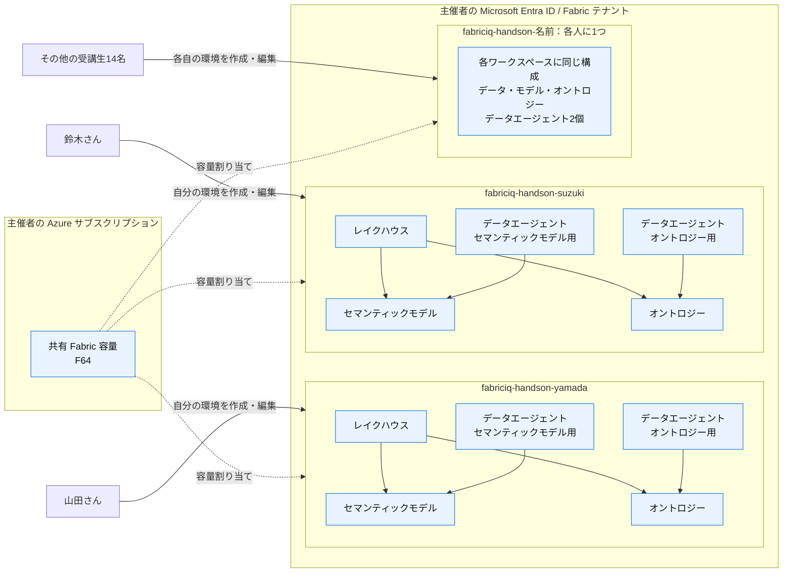

実線は操作・データ参照、破線は容量の割り当てを表します。Azure サブスクリプションで購入した容量を、同じテナントの各ワークスペースへ割り当てます。

図は CSV をレイクハウスに取り込み、モデルとオントロジーを作る構成です。図中のデータエージェントは、オントロジー内の組み込みエージェントとは別の Fabric アイテムです。

## 2. 受講生アカウントとライセンス

主催者テナントで使用する16名分のアカウントを確定します。容量の利用許可など、ユーザーを個別に指定できる設定では、受講生一人ひとりに権限を付与しても構いません。

ただし、**受講生をセキュリティグループ（例：`FabricIQ-Workshop-Participants`）にまとめると、複数の設定で同じグループを指定でき、参加者の追加・削除も管理しやすくなります。** 以降は、このグループを使用する例で説明します。

テナント設定には、許可対象を限定する際にセキュリティグループの指定が必要なものがあります。その場合は、受講生が所属するグループを指定してください。

**ライセンス管理者は、受講生16名それぞれに Power BI Pro を割り当てます。Power BI Premium Per User（PPU）でも利用できます。**

- **Microsoft 365 E5 をご契約の場合**：Power BI Pro が含まれます。対象ユーザーにライセンスを割り当て、Power BI Pro サービスを有効にしてください。
- **Power BI Pro を含む契約がない場合**：Power BI Pro を別途用意し、対象ユーザーに割り当ててください。

Microsoft 365 管理センターの対象ユーザーの「ライセンスとアプリ」で、割り当てと有効化を確認します。

別テナントのアカウントを使う場合は、B2B ゲストの招待、ライセンス、利用機能の対応・権限を事前に確認してください。

出典：[Power BI のライセンス別機能](https://learn.microsoft.com/en-us/power-bi/fundamentals/service-features-license-type)、[組織向けライセンス管理・E5](https://learn.microsoft.com/en-us/fabric/enterprise/powerbi/service-admin-power-bi-licensing)。

## 3. Fabric容量

主催者の Azure サブスクリプションで、**従量課金 F64（64 CU）を1つ用意**します。受講生16名で共有し、ハンズオン開始時に利用できる状態にします。

リージョンは東日本（Japan East）でも、その他のリージョンでも構いません。演習で使用する機能が提供され、組織のデータ所在地ポリシーに適合する任意のリージョンを選択してください。開催前に[リージョンの提供状況](https://learn.microsoft.com/en-us/fabric/admin/region-availability)を確認します。AI の域外処理・保存の許可については、選択したリージョンに応じて4.6の設定を確認してください。

### 費用の目安

参考として、F64 の容量基本料金は、**東日本（Japan East）で約2,015円／時間**です（税別、2026年10月19日時点）。料金は選択するリージョンによって異なります。ユーザーライセンス、OneLake ストレージ、追加利用料等は別途必要です。

前日に作成し、利用しない時間帯は一時停止、終了後に停止・削除することで、容量の基本料金を稼働時間分に抑えられます。容量停止後も、保存データのストレージ料金等が発生する場合があります。

ワークスペースを分けても、計算リソースは同じ F64 容量を共有します。ワークスペースごとに CU が分離・予約されるわけではありません。

出典：[Fabric 公式料金](https://azure.microsoft.com/en-us/pricing/details/microsoft-fabric/)、[公式料金計算データ：JPY](https://azure.microsoft.com/api/v3/pricing/microsoft-fabric/calculator/?culture=en-us&discount=mosp&currency=JPY)、[容量の停止・再開](https://learn.microsoft.com/en-us/fabric/enterprise/pause-resume)。

## 4. テナント設定

> 画像は設定例であり、「組織全体」への許可は必須ではありません。受講生の機能利用に関する設定で許可対象を限定できる場合は、2章の受講生グループなど、受講生が所属するグループが許可対象に含まれていることを確認してください。

Fabric 管理者が **管理ポータル → テナント設定**で設定します。次の手順で画面を開いてください。

1. Fabric 管理者のアカウントで [Microsoft Fabric](https://app.fabric.microsoft.com/) にサインインします。
2. 画面右上の **設定（歯車アイコン）**を選択します。
3. 設定パネルの **ガバナンスと管理 → 管理ポータル**を選択します。
4. 管理ポータルの左側メニューで **テナント設定**を選択します。

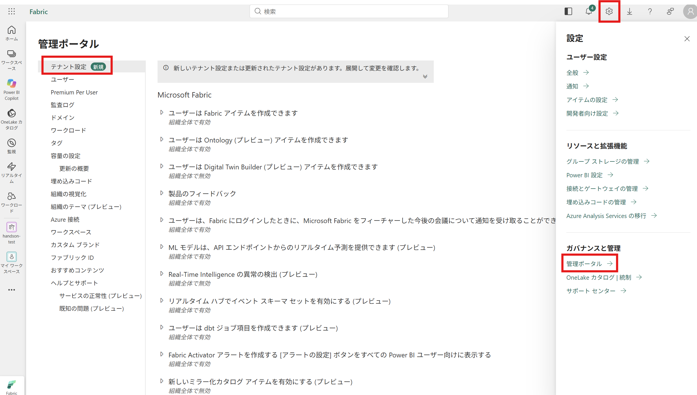

### 4.1 ワークスペースの作成

**Create workspaces**

「ワークスペースの設定」の「ワークスペースの作成」で、受講生がワークスペースを作成できることを確認します。許可対象を限定する場合は、受講生が所属するセキュリティグループを指定します。各受講生が自分のワークスペースを作成するために必要です。

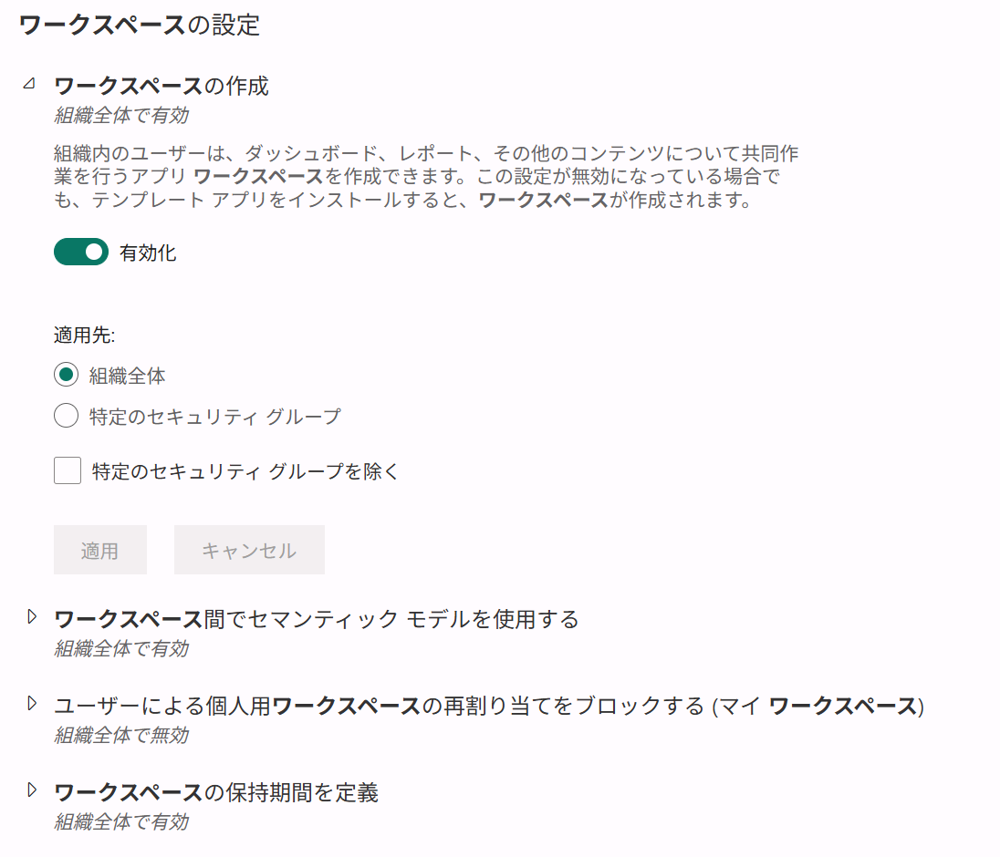

### 4.2 Fabric アイテムの作成

**Users can create Fabric items**

「Microsoft Fabric」の「ユーザーは Fabric アイテムを作成できます」を有効にします。オントロジーなどの Fabric アイテム作成に必要です。Power BI アイテムの利用可否とは別の設定です。容量側で設定が制限されていないことも確認します。

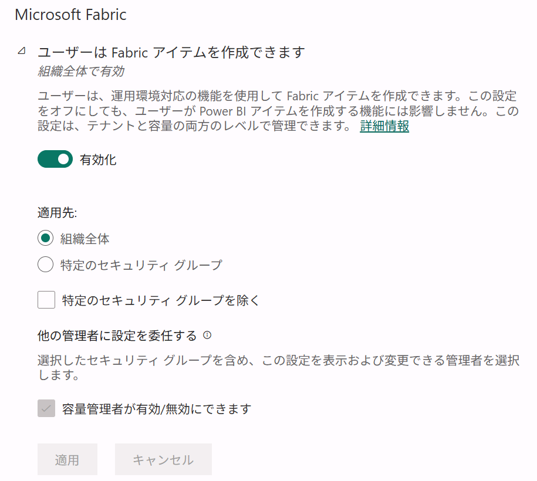

### 4.3 オントロジーの作成

**Users can create ontology (preview) items**

「ユーザーは Ontology（プレビュー）アイテムを作成できます」を有効にします。

画像の黄色の注意書きに従い、次の関連設定も有効になっていることを確認してください。

- **「ユーザーが Graph を作成できる」設定**：オントロジーで使用する Graph の作成を許可します。
- **「ユーザーはデータ エージェント アイテムの種類を作成および共有できる」設定**：データエージェントからオントロジーを利用するために必要です。

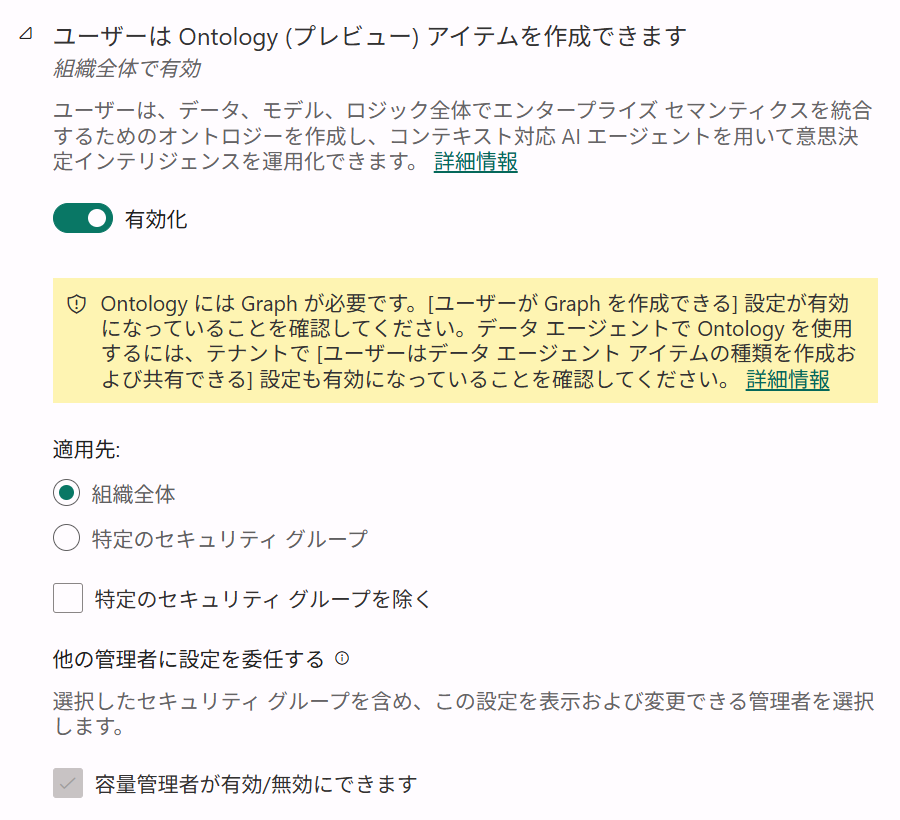

### 4.4 Copilot・AI 機能の利用

**Users can use Copilot and other features powered by Azure OpenAI**

「Copilot と AI」の、**Azure OpenAI を利用した** Copilot・AI エージェントの利用を許可する設定を確認します。**既定は有効です。** データエージェントを利用する受講生が許可対象に含まれ、容量側でも制限されていないことを確認します。

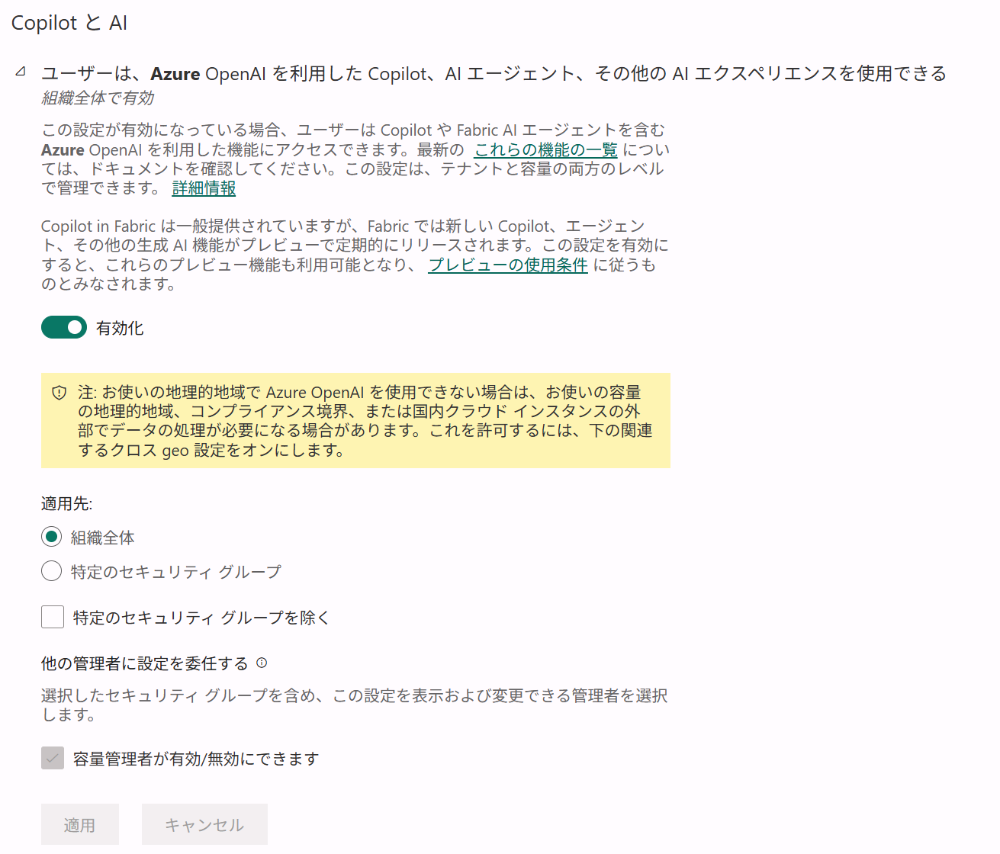

### 4.5 Fabric Copilot 容量の指定許可

**Capacities can be designated as Fabric Copilot capacities**

「容量は Fabric Copilot 容量として指定できます」を確認します。**既定は有効です。** 有効で対象の容量管理者に許可されていれば変更不要です。組織で無効化・対象制限している場合に確認します。

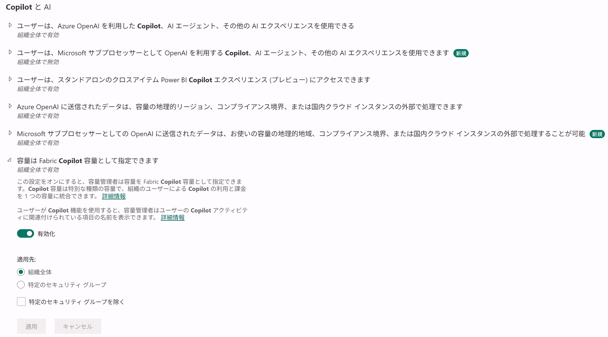

### 4.6 Azure OpenAI の域外処理・保存

**Data sent to Azure OpenAI can be processed outside your capacity's geographic region, compliance boundary, or national cloud instance**

画像は、**Azure OpenAI に送信されたデータの域外処理**を許可する設定です。**既定は無効です。** Japan East でのデータエージェント利用に必要なため、組織の承認を得て有効化します。

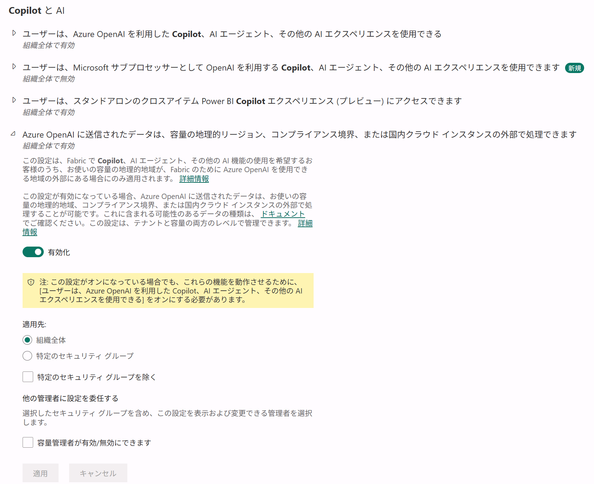

画像の処理許可とは別に、同じ「Copilot と AI」内の次の**保存許可**も確認してください。

**Data sent to Azure OpenAI can be stored outside your capacity's geographic region, compliance boundary, or national cloud instance**

「Azure OpenAI に送信されたデータは、容量の地理的リージョン、コンプライアンス境界、または国内クラウド インスタンスの外部に格納できます」を確認します。こちらも**既定は無効です。** Japan East でのデータエージェント利用に必要なため、会話履歴の域外保存について組織の承認を得て有効化します。**域外処理の許可だけでは、この保存許可は有効になりません。**

画像の黄色の注意書きに従い、4.4 の Azure OpenAI を利用した Copilot・AI 機能の利用許可も有効になっていることを確認してください。

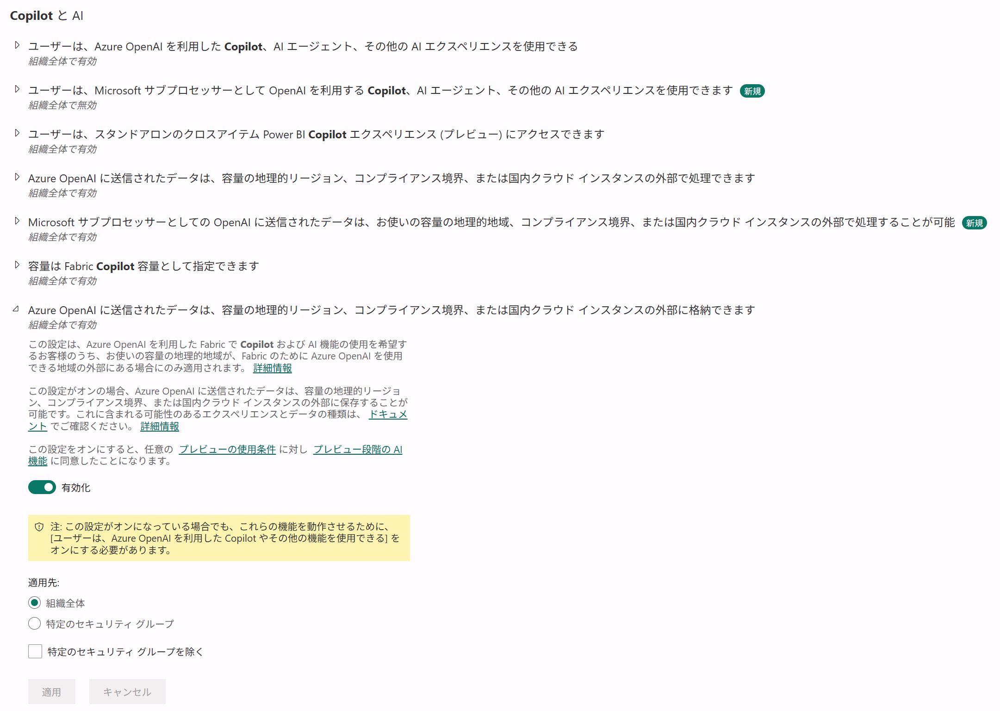

> 東日本に容量を作っても、AI 処理・保存まで日本国内に限定されるわけではありません。域外処理・保存について組織の承認を得たうえで設定してください。

### 設定の適用と反映

設定を変更した場合は、画面下部の **適用**を選択します。

容量に委任されている設定も確認し、テナント・容量の両方で受講生に必要な機能が許可されていることを確認します。

データエージェントの設定は反映まで最大1時間かかる場合があります。開催直前の変更は避けてください。

出典：[ワークスペース作成のテナント設定](https://learn.microsoft.com/en-us/fabric/admin/portal-workspace#create-workspaces)、[オントロジーに必要な設定](https://learn.microsoft.com/en-us/fabric/iq/ontology/overview-tenant-settings)、[Copilot 設定と既定値](https://learn.microsoft.com/en-us/fabric/admin/service-admin-portal-copilot)、[データエージェントに必要な設定](https://learn.microsoft.com/en-us/fabric/data-science/data-agent-tenant-settings)、[Fabric のテナント設定](https://learn.microsoft.com/en-us/fabric/admin/service-admin-portal-microsoft-fabric-tenant-settings)。

## 5. 受講生への権限設定と案内

### 受講生への容量割り当て権限

**容量管理者**は、対象 F64 容量の設定にある **Contributor permissions** に、受講生グループまたは受講生のアカウントを個別に追加します。これにより、受講生が自分で作成したワークスペースを F64 容量へ割り当てられます。

1. Fabric の **管理ポータル → 容量の設定**で **ファブリック容量**タブを選択し、一覧から対象の F64 容量名を選択します。

   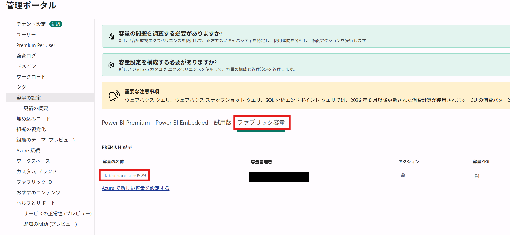

   > 画像の容量名・SKU は画面例です。本ワークショップでは、3章で準備した **F64** 容量を選択してください。

2. **詳細**タブで、画像下部の **共同作成者のアクセス許可（Contributor permissions）**を展開します。
3. **特定のユーザーやグループ**を選択し、2章の受講生グループ（例：`FabricIQ-Workshop-Participants`）を入力欄に追加して、**適用**します。個別に設定する場合は、受講生全員のアカウントを追加してください。

    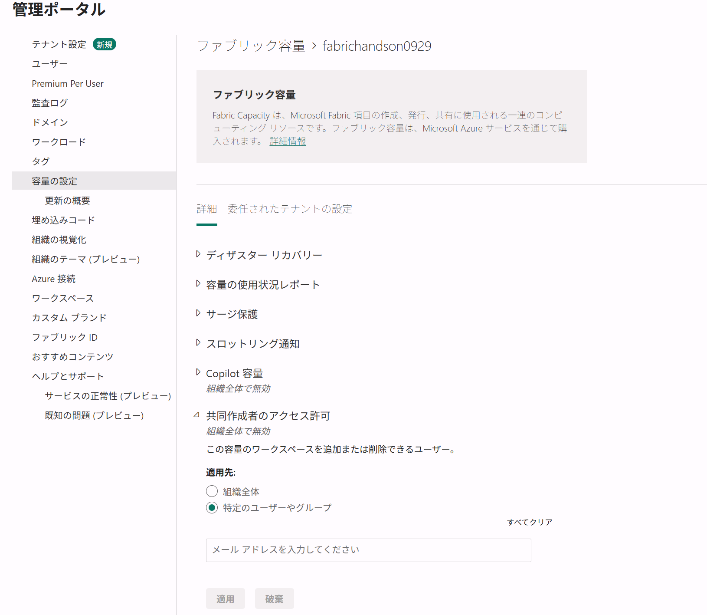

> 画像は許可対象を追加する前の状態です。入力欄に対象グループまたは各受講生のアカウントを追加してから、**適用**してください。

出典：[容量の割り当て権限](https://learn.microsoft.com/en-us/fabric/governance/onelake-catalog-capacities#manage-capacity-settings)。

### 受講生へ事前に案内する情報

- 使用するアカウントとテナント
- 共有 F64 容量名
- [ハンズオンの操作手順](./handson.md)
